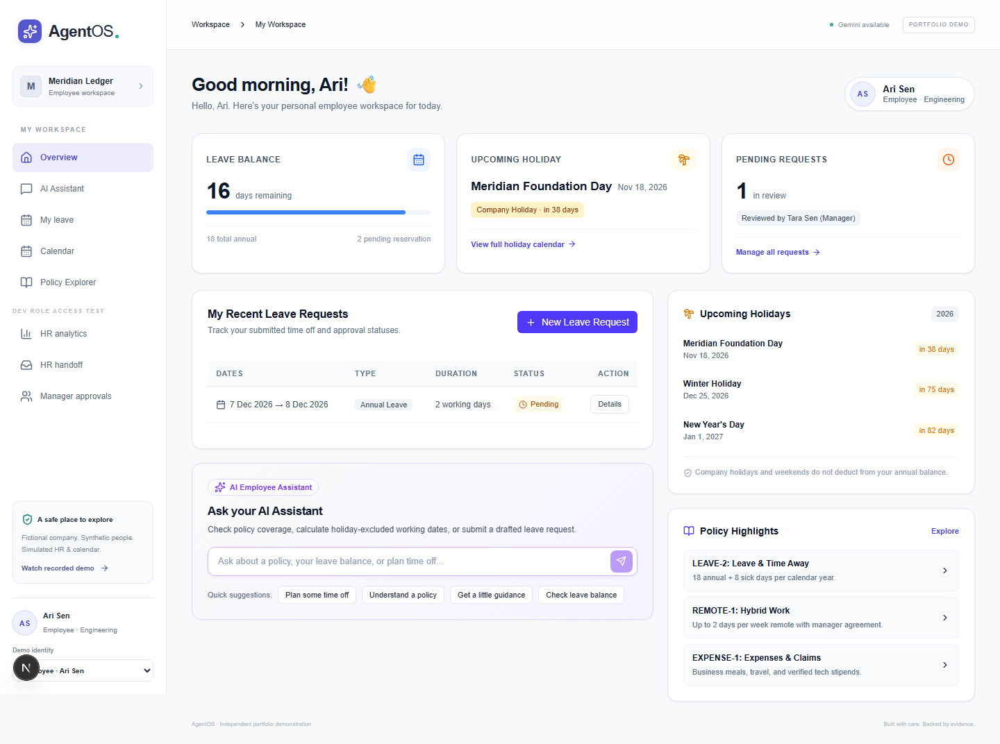

# AgentOS — Employee Support and HR Workflow Assistant

> 📖 **Comprehensive Architecture & Technical Handbook:** Read [FULL_PROJECT.md](FULL_PROJECT.md) for the complete 17-part engineering manual, system architecture diagrams, database designs, API specifications, and 50+ interview questions.

AgentOS is an independent portfolio project for a fictional fintech company, Meridian Ledger. It demonstrates evidence-backed policy answers, durable leave approvals, aggregate HR analytics, human handoff, and a real MCP client/server boundary. Every person, policy, calendar event, and operational record is synthetic.



## What works

- Policy questions return server-resolved citations with document/version/effective-date metadata and excerpts.
- Leave preparation calls scoped balance, calendar, and working-day tools; company holidays and conflicts are shown without editing meetings.
- Employee confirmation is bound to the exact expiring draft. It submits a pending request and does not approve leave.
- Direct managers make a separate authorized decision. Submission and approval are revalidated, locked, and idempotent.
- Unsupported or contradictory evidence offers an employee-confirmed HR handoff and persists a real ticket.
- HR analysts can run four deterministic aggregate reports and restricted natural-language SQL with SQLGlot validation.
- FastAPI launches a private FastMCP child over stdio, discovers nine tools, calls them, validates results, and logs factual events.
- LangGraph state is checkpointed in PostgreSQL. A two-process proof resumes an interrupted workflow after the first process exits.
- The UI includes employee assistant, leave, manager queue, HR analytics, HR handoff, and restricted execution/evaluation workspaces.

## Architecture

```text
Next.js UI
  -> FastAPI: verified session, role and workflow ownership
  -> LangGraph coordinator
       -> policy / workflow / analytics specialists
  -> MCP client -> private FastMCP stdio child
  -> deterministic services -> PostgreSQL + pgvector
  -> PostgreSQL checkpoints, approvals, audit events and reporting views
```

See [architecture and access paths](docs/ARCHITECTURE.md) for the exact RLS/scoped-query model.

## Quick start on Windows without Docker

Requirements: Node 24+, `uv`, and PowerShell. The workspace script downloads and runs a persistent PostgreSQL cluster on loopback.

```powershell
Copy-Item .env.example .env
Copy-Item frontend/.env.example frontend/.env.local
npm.cmd install
npm.cmd run db:start
```

Keep the database process open. In another terminal:

```powershell
uv sync --frozen
uv run alembic upgrade head
uv run python -m agentos.seed
uv run python -m agentos.retrieval
uv run uvicorn agentos.api:app --host 127.0.0.1 --port 8000
```

In a third terminal:

```powershell
Set-Location frontend
npm.cmd install
npm.cmd run dev
```

Open `http://localhost:3000`. Development mode provides three signed synthetic identities. It cannot be enabled when `ENVIRONMENT=hosted`.

## Docker PostgreSQL alternative

```powershell
docker compose up -d postgres
uv run alembic upgrade head
uv run python -m agentos.seed
uv run python -m agentos.retrieval
```

This route supplies pgvector. Local portable PostgreSQL may use the visibly labeled JSON-cosine fallback if the extension is absent.

## Verification

```powershell
uv run ruff check backend scripts tests
uv run pytest -q
Set-Location frontend
npm.cmd run build
npm.cmd test
```

Verified results:

| Check | Result |
|---|---:|
| Frozen deterministic evaluation | 60 / 60 passed |
| Expanded backend/security suite | 72 / 72 passed |
| Essential Playwright journeys | 3 / 3 passed |
| Unauthorized access/actions observed in fixed evaluation | 0 |
| Duplicate submissions observed in fixed evaluation | 0 |
| MCP tools discovered and invoked | 9 |
| Supabase pgvector/checkpoint/approval/reporting smoke | Passed |

The fixed evaluation is deterministic and synthetic. It is not a live-model benchmark. Read [evaluation details](docs/EVALUATION.md) and [limitations](docs/LIMITATIONS.md) before quoting these numbers.

## Gemini and Supabase

The model name is configurable; do not guess a default. List the models available to the account, confirm tool calling, and verify that billing is disabled/free-tier use is acceptable before setting:

```ini
MODEL_MODE=live
GEMINI_MODEL=<verified model name>
GEMINI_API_KEY=<server-side secret>
GEMINI_FREE_TIER_VERIFIED=true
```

Live calls have a persisted daily budget, a per-run bound, one-attempt SDK retries, and explicit quota handling. The free tier may use submitted synthetic content to improve Google products; never put real enterprise data into this demo.

Hosted authentication verifies Supabase JWT signatures and then maps `sub` to an employee server-side. Browser role or employee fields are rejected. The supplied Supabase project was provisioned with separate runtime and aggregate-report roles; `.env.hosted` is ignored and must remain local.

## Demonstration

Follow the [2–3 minute demo script](docs/DEMO_SCRIPT.md). Screenshots are in `artifacts/screenshots/`; actual Playwright recordings of the policy/leave/manager, handoff/analytics, and cancellation/mobile journeys are in `artifacts/recordings/`. The in-app recorded replay is visibly labeled and performs no live execution.

## Deployment

`render.yaml` and `frontend/vercel.json` are ready. Follow [the deployment checklist](docs/DEPLOYMENT.md). Deployment was not performed because no Vercel or Render account session was available; no paid service or trial was activated.

## Repository guide

- `backend/agentos/`: API, auth, graph, MCP, retrieval, analytics, and business services.
- `migrations/`: operational, reporting, checkpoint, and quota schema changes.
- `policies/`: five fictional policies plus isolated evaluation fixtures.
- `evaluation/`: frozen final cases and separate development questions.
- `tests/`: 60-case evaluation plus authentication/concurrency hardening.
- `artifacts/`: measured results, integration proofs, and screenshots.
- `docs/`: product brief, architecture, deployment, demo, evaluation, limits, and resume bullet.

## Security and data handling

Secrets are server-side and ignored by Git. Audit events contain tool names, safe argument keys, outcomes, durations, identities, transitions, and usage metadata rather than hidden reasoning or raw sensitive text. Retention is bounded by `LOG_RETENTION_DAYS`; run `python -m agentos.maintenance` as an operator task. There is intentionally no public seed-reset endpoint.

License: portfolio demonstration; no affiliation with Angel One or any real employer.

