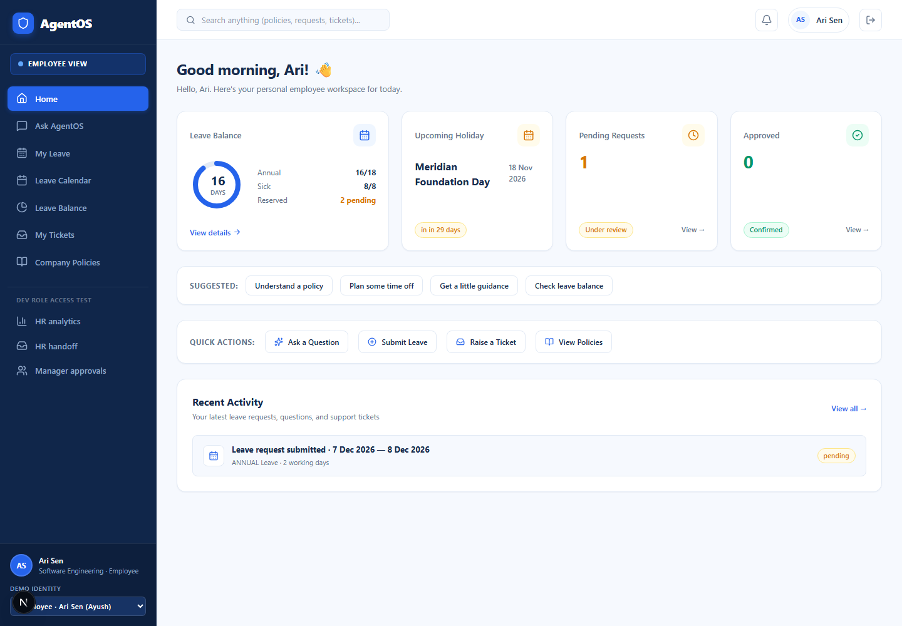
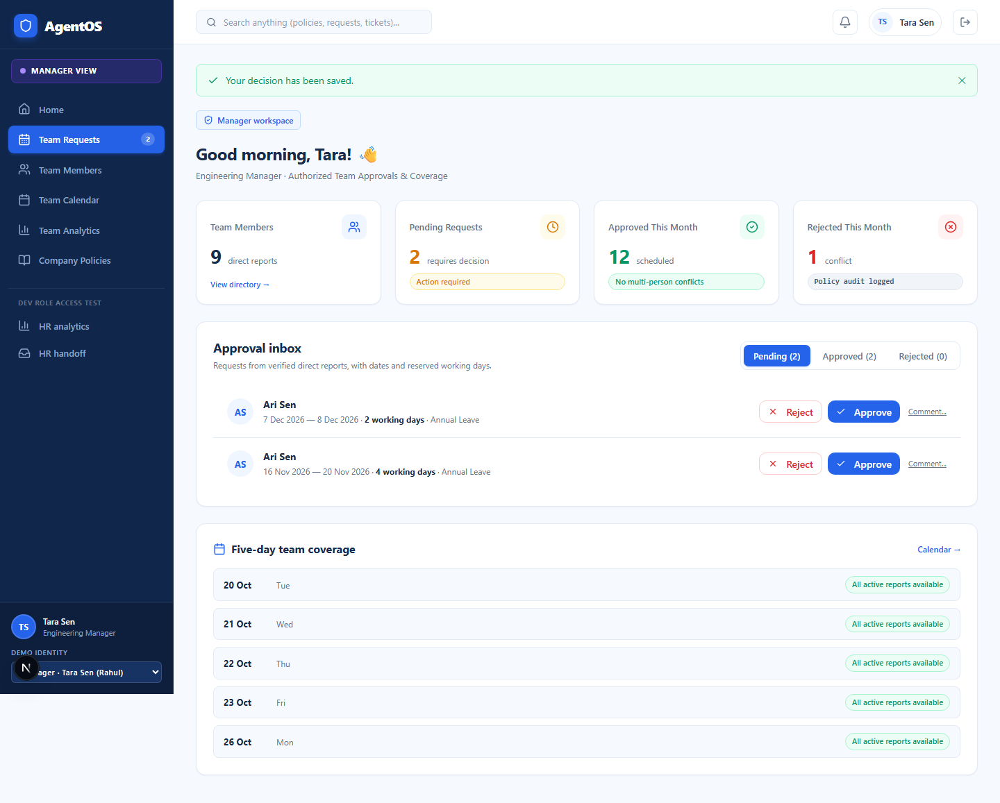
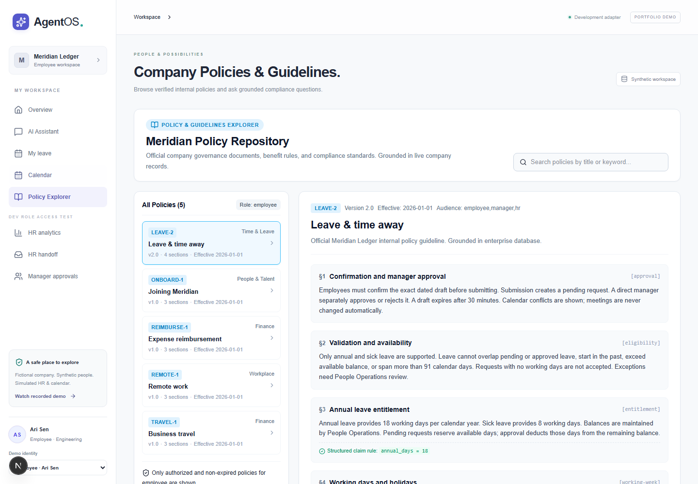
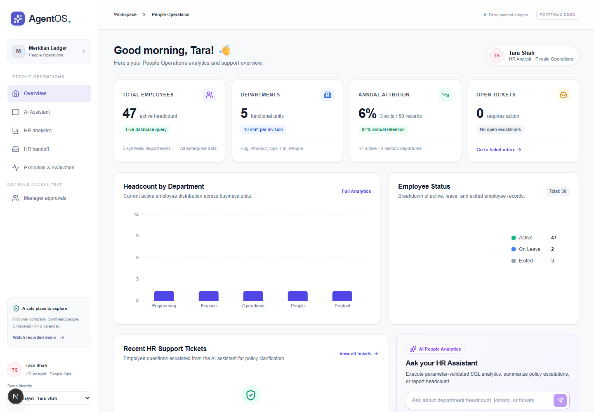
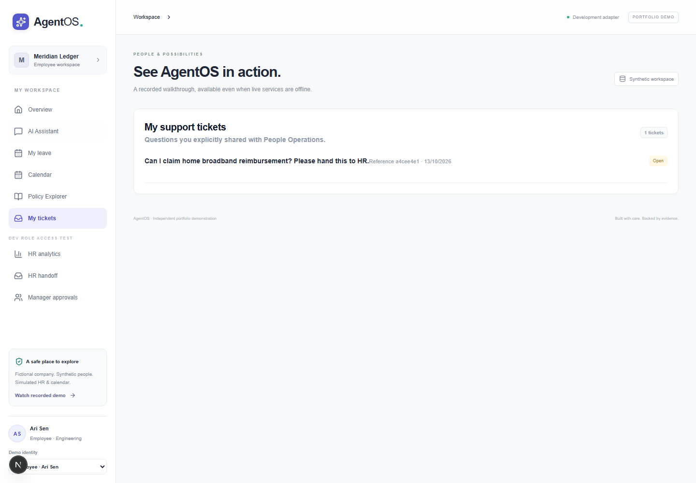
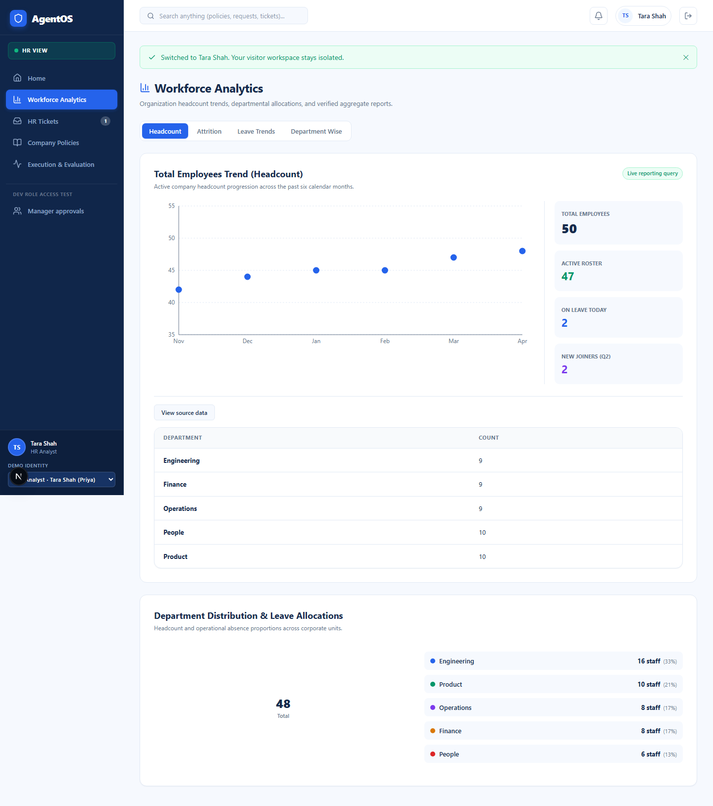
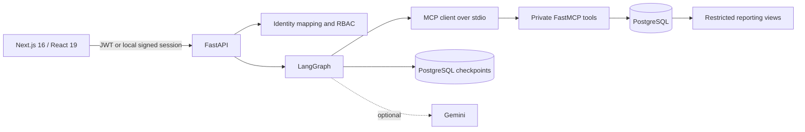

# AgentOS

**One intelligent workspace for company knowledge, business insights, employee workflows, and human support.**

AgentOS is an independent portfolio application for the fictional company **Meridian Ledger**. It demonstrates grounded policy support, transactional leave workflows, manager approvals, HR handoff, and restricted workforce analytics. Every person, policy, meeting, ticket, and business record is synthetic.

- **Frontend:** [agent-os-sigma-vert.vercel.app](https://agent-os-sigma-vert.vercel.app)
- **API health:** [agentos-api-2ima.onrender.com/health](https://agentos-api-2ima.onrender.com/health)
- **Technical handbook:** [docs/FULL_PROJECT.md](docs/FULL_PROJECT.md)
- **Project guide:** [docs/PROJECT_GUIDE.md](docs/PROJECT_GUIDE.md)
- **Current limitations:** [docs/LIMITATIONS.md](docs/LIMITATIONS.md)

> The Render free service can take tens of seconds to wake. The frontend performs one shared readiness check, shows a connection state, and retries only safe GET requests within fixed budgets. The recorded replay remains available when live services are unavailable.

## What is implemented

- Policy search with section metadata, effective-date/audience checks, hybrid PostgreSQL FTS plus pgvector or labeled cosine fallback, and server-resolved citations.
- A bounded LangGraph coordinator with policy, workflow, analytics, clarification, approval, and execution nodes.
- A private FastMCP stdio subprocess exposing nine permission-scoped tools.
- Leave calculation, balance reservation, conflict checks, an expiring employee confirmation, and separate direct-manager review.
- PostgreSQL row locks, payload hashes, idempotency keys, audit events, and durable LangGraph checkpoints.
- Supabase JWT verification through JWKS and server-side `auth_identities` mapping in hosted mode.
- Dedicated Employee, Manager, and HR dashboards using role-protected APIs.
- Four approved aggregate HR reports validated with SQLGlot and executed through a read-only reporting connection.
- Shared frontend cold-start readiness, bounded GET retries, one Supabase refresh on 401, explicit stale-data messages, and no automatic mutation retry.
- Deterministic local fixtures and an opt-in richer demo generator with 50 employees, 70 additional leave requests, 40 tickets, dry-run, validation, and guarded local reset.

## Product views

| Employee workspace | Manager workspace |
|---|---|
|  |  |

| Policy Explorer | HR workspace |
|---|---|
|  |  |

| Employee tickets | Workforce analytics |
|---|---|
|  |  |

Additional verified screenshots are in [docs/images](docs/images/).

## Architecture



The model can interpret or explain a request. Deterministic backend code remains authoritative for identity, authorization, dates, balances, SQL, state transitions, and writes. Leave submission, manager review, and HR handoff require explicit human action.

## Authentication and demo access

Hosted users sign in with provisioned synthetic Supabase accounts. Passwords are not published in this repository.

A secure public-demo path exists in code but is disabled unless all of the following are deliberately configured:

1. a separate synthetic-only Supabase database and Auth project;
2. anonymous Auth enabled for that demo project;
3. `ENABLE_PUBLIC_DEMO=true` on a backend connected only to the demo project; and
4. a frontend using that demo project's publishable key.

The backend accepts persona selection only for a verified Supabase JWT whose `is_anonymous` claim is true. It creates a separate tenant per visitor and derives roles from server-owned employee rows. Cloud activation remains an infrastructure approval step.

## Technology

- Next.js 16, React 19, TypeScript, Recharts, Radix UI, Lucide
- FastAPI, Python 3.12+, SQLAlchemy, Alembic, psycopg
- LangGraph with PostgreSQL checkpoints
- MCP Python SDK / FastMCP over stdio
- PostgreSQL full-text search, pgvector, FastEmbed
- Supabase Auth with ES256/RS256 verification
- SQLGlot restricted analytics
- Optional Google GenAI provider
- Pytest, Ruff, Playwright, GitHub Actions

Exact audited versions and architectural details are in the [technical handbook](docs/FULL_PROJECT.md).

## Run locally

Requirements: Node.js 22+, Python 3.12+, [`uv`](https://docs.astral.sh/uv/), npm, and PowerShell on Windows.

```powershell
Copy-Item .env.example .env
Copy-Item frontend/.env.example frontend/.env.local
npm.cmd install
uv sync --frozen
npm.cmd run db:start
```

Keep the database terminal open. In a second terminal:

```powershell
uv run alembic upgrade head
uv run python -m agentos.seed
uv run python -m agentos.retrieval
uv run uvicorn agentos.api:app --host 127.0.0.1 --port 8000
```

In a third terminal:

```powershell
Set-Location frontend
npm.cmd ci
npm.cmd run dev
```

Open <http://127.0.0.1:3000>. Development mode creates a signed local synthetic Employee session and exposes a clearly labeled persona switcher for role testing.

### Rich isolated local demo fixtures

Preview without a database write:

```powershell
uv run python -m agentos.demo_seed plan --dry-run
```

Create or validate the deterministic rich tenant:

```powershell
uv run python -m agentos.demo_seed seed
uv run python -m agentos.demo_seed validate
```

Reset is intentionally difficult and works only for a `local_demo` tenant on a loopback database:

```powershell
$env:DEMO_ENVIRONMENT='true'
uv run python -m agentos.demo_seed reset --tenant-id 00000000-0000-0000-0000-0000000000d0
```

The command refuses hosted/non-loopback targets, tenants of another kind, or execution without the explicit environment acknowledgement. Never point it at Supabase.

## Tests

```powershell
uv run ruff check backend scripts tests
uv run pytest -q
Set-Location frontend
npm.cmd run typecheck
npm.cmd run build
npm.cmd test
```

At deployed commit `b1bd01e`, the recorded deployment gate passed 81 backend tests and 22 Playwright tests. The current local implementation passes 84 backend tests and all 22 Playwright tests. Deterministic tests demonstrate workflow contracts; they are not a benchmark of live Gemini reasoning.

GitHub Actions runs backend lint/tests, frontend typecheck/build, tracked-secret pattern checks, and a Playwright suite against an isolated CI PostgreSQL service without production credentials.

## Security model

- Exact-origin CORS; no wildcard hosted origin.
- Server-verified JWT signature, issuer, audience, expiry, subject, and database identity mapping.
- Role checks at FastAPI and domain-service boundaries.
- Signed five-minute MCP context tokens and specialist tool allowlists.
- Tenant-scoped operational queries and transaction-local reporting scope.
- Read-only analytics transactions, one approved view, 100-row limit, and 2-second statement timeout.
- Payload-bound expiring confirmations, database row locks, and idempotency constraints.
- No automatic retries for POST actions, approvals, submissions, ticket writes, or other mutations.

## Known boundaries

Calendar events are simulated database fixtures. Policy administration is read-only. Public one-click demo access is not active until a separate cloud demo environment is approved and configured. Gemini is optional and free-tier availability is not guaranteed. An authenticated post-`b1bd01e` production Manager browser journey has not been claimed without an authorized session.

See [docs/BASELINE_AUDIT.md](docs/BASELINE_AUDIT.md), [docs/DEMO_ARCHITECTURE.md](docs/DEMO_ARCHITECTURE.md), [docs/DEMO_DATA.md](docs/DEMO_DATA.md), [docs/ARCHITECTURE.md](docs/ARCHITECTURE.md), [docs/DEPLOYMENT.md](docs/DEPLOYMENT.md), and [docs/LIMITATIONS.md](docs/LIMITATIONS.md).

## License

No license file is currently included. Add or change licensing only after the repository owner chooses the intended terms.
