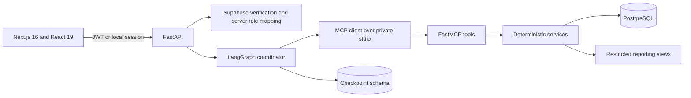

# AgentOS architecture

AgentOS uses a modular monolith: one Next.js frontend, one FastAPI backend, one private MCP subprocess, and PostgreSQL. This keeps deployment appropriate for a portfolio project while preserving explicit security and workflow boundaries.

## Trust boundaries

- The browser supplies a signed session, never a trusted role or employee ID.
- FastAPI resolves identity from server-owned mappings and enforces role access.
- MCP calls use short-lived context tokens and specialist allowlists.
- Queries include tenant and employee scope where applicable.
- Employee confirmation and Manager review are separate decisions.
- Mutations are single-attempt; safe GET requests alone receive bounded retry.
- Retrieved policy text cannot grant permissions or initiate writes.

## Runtime behavior

The frontend performs one shared readiness check before authenticated bootstrap requests. Supabase sessions refresh at most once after a 401. A 502/503/504 is treated as availability failure and does not sign the user out or replace data with an empty success state.

LangGraph invokes permission-scoped MCP tools, pauses for human confirmation, and stores checkpoints in PostgreSQL. Optional Gemini inference may phrase grounded responses but cannot bypass backend rules.

See [CODEBASE_GUIDE.md](CODEBASE_GUIDE.md) and [FULL_PROJECT.md](FULL_PROJECT.md).
