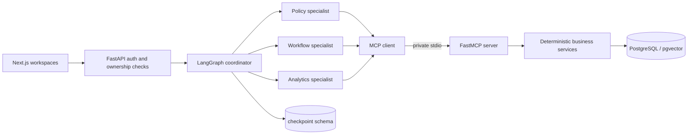

# Architecture and access paths

The FastAPI boundary verifies a development-signed session or a Supabase JWT. The employee and role come from `auth_identities` and `employees`; request bodies cannot grant either. The MCP client creates a short-lived purpose-bound token for every call. The MCP server verifies that token independently and invokes the same deterministic services used by tests.

Operational tables use scoped application queries and transactions. The runtime role owns only AgentOS tables, so ownership bypasses RLS; the application never claims otherwise. Direct browser roles have operational access revoked. The reporting role has read-only access only to the `reporting` schema, a restricted search path, a two-second statement timeout, and aggregate views filtered by transaction-local tenant and period settings.

LangGraph checkpoints live in a separate `checkpoints` schema. Employee confirmation records the exact payload hash and expiry. Submission happens after the interrupt and is idempotent. Manager review creates a separate server-side approval and locks the employee balance before revalidation and deduction.

