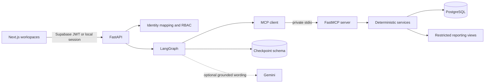
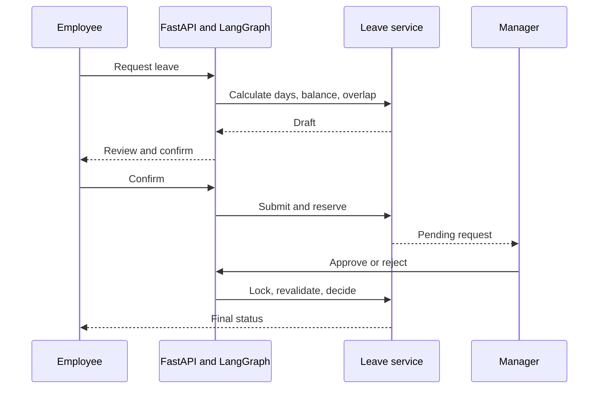

# AgentOS codebase guide

AgentOS is a synthetic employee-operations application for the fictional company Meridian Ledger. It demonstrates grounded policy assistance, leave workflows, Manager approvals, HR support tickets, and restricted workforce analytics across Employee, Manager, and HR workspaces.

## Start here

1. Read this guide for the implementation map.
2. Use [DEVELOPER_QUICKSTART.md](DEVELOPER_QUICKSTART.md) to run the application.
3. Read [FULL_PROJECT.md](FULL_PROJECT.md) for detailed architecture and interview material.
4. Check [LIMITATIONS.md](LIMITATIONS.md) before making product or production claims.

## Technology stack

| Layer | Technology | Purpose |
|---|---|---|
| Browser | Next.js 16, React 19, TypeScript | Role-aware UI and session handling |
| API | FastAPI, Pydantic | HTTP validation, authentication, and authorization |
| Data | PostgreSQL, SQLAlchemy, Alembic | Transactions, records, reporting, and migrations |
| Authentication | Supabase Auth | Hosted sessions and signed JWTs |
| Agent orchestration | LangGraph | Bounded routing, specialists, and confirmation interrupts |
| Tools | FastMCP over private stdio | Typed access to deterministic services |
| Retrieval | PostgreSQL FTS, optional pgvector/FastEmbed | Grounded policy search and citations |
| Analytics | SQLGlot and reporting views | Approved aggregate HR reports |
| Tests | Pytest, Playwright, Ruff, TypeScript | Domain, security, browser, and build verification |

Gemini is optional. Identity, permissions, SQL validation, workflow state, and database writes remain controlled by backend code.

## System architecture



## Repository map

```text
AgentOS/
├── backend/agentos/       FastAPI, services, AI orchestration, MCP, and data access
├── frontend/app/          Next.js entry point and global styles
├── frontend/components/   Layout, role views, calendar, team, and UI primitives
├── frontend/lib/          API transport, Supabase client, dates, and utilities
├── frontend/tests/        Playwright journeys and resilience coverage
├── tests/                 Backend workflow, security, and evaluation tests
├── migrations/            Alembic schema history
├── policies/              Synthetic policy corpus and adversarial fixtures
├── scripts/               Database, setup, smoke, and diagnostic utilities
├── evaluation/            Frozen deterministic evaluation cases
├── artifacts/             Tracked portfolio evidence and recorded journeys
└── docs/                  Current technical and product documentation
```

## Frontend lifecycle

The browser entry point is `frontend/app/page.tsx`. It waits for the shared `GET /health` readiness check, restores the Supabase session, resolves `GET /auth/me`, loads role-appropriate data, and renders `AppShell` with the selected view.

Every request passes through `frontend/lib/api.ts`. It attaches the bearer token, permits one bounded refresh after a 401, retries only idempotent GET requests after network/502/503/504 failures, and never retries mutations automatically.

Main screens live under `frontend/components/views/`. Shared calendar and team-directory implementations live in their named component directories.

## Backend lifecycle

The entry point is `agentos.api:app`.

1. FastAPI starts the PostgreSQL checkpoint saver and private MCP subprocess.
2. Middleware applies origin checks, structured errors, CORS, and security headers.
3. The identity dependency verifies a local session or Supabase JWT.
4. Supabase subjects map through `auth_identities`; browser role text is never trusted.
5. Routes call scoped services directly or execute LangGraph.
6. Services recheck authorization and use explicit transactions for protected writes.

## Authentication and roles

Hosted sign-in uses Supabase email/password authentication. The API verifies signature, issuer, audience, expiry, and subject, then resolves the employee and role from PostgreSQL.

The synthetic portfolio account belongs to the fixed seeded demo tenant. Its sidebar selector may switch only among server-owned Employee `E001`, Manager `E010`, and HR `E050` personas. Arbitrary employees and normal production tenants are rejected. Optional anonymous visitor isolation remains disabled unless a dedicated synthetic Supabase environment enables it.

Frontend navigation improves usability; backend role checks remain authoritative.

## Data, agents, and tools

PostgreSQL stores tenants, identities, employees, balances, leave requests, approvals, tickets, runs, policies, chunks, calendar events, audit events, and model budgets. LangGraph checkpoints use a separate schema. Reporting views use a restricted read-only connection.

`graph.py` routes supported requests to policy, workflow, analytics, or clarification nodes. Leave submission and HR handoff pause for employee confirmation. Manager approval is a later decision.

`mcp_client.py` calls the private MCP server with short-lived purpose-bound context tokens. `retrieval.py` filters policy versions by audience and date before combining full-text and optional vector ranking. Citation content is resolved again by the server before display.

## Leave workflow



## Feature-to-code map

| Feature | Frontend | Backend | Tests |
|---|---|---|---|
| Authentication and persona switching | `app/page.tsx`, `lib/supabase.ts`, login and shell views | `api.py`, `auth.py`, `public_demo.py` | `test_hardening.py`, `resilience.spec.ts` |
| Employee dashboard | `employee-home-view.tsx` | `/balances`, `/leave`, `/calendar` | Calendar and feature suites |
| Assistant | `ask-agentos-view.tsx` | Graph, model, routing, and MCP modules | Evaluation and journey suites |
| Policies and RAG | `company-policies-view.tsx` | `retrieval.py`, policy and citation routes | Evaluation and feature suites |
| Leave workflow | Submit and leave views | `services.py`, chat and run routes | Both backend suites and journeys |
| Manager approvals | `manager-home-view.tsx` | Manager routes and approval services | Hardening and journey suites |
| Team directory/calendar | Team and calendar components | `/manager/team`, `/calendar` | Feature and calendar suites |
| Employee and HR tickets | Ticket view components | Ticket routes and handoff services | Backend and journey suites |
| HR analytics | HR and workforce analytics views | `analytics.py`, HR routes | Evaluation and journey suites |
| Cold-start recovery | `lib/api.ts`, connection UI | `/health`, middleware | Resilience and hardening suites |

## Adding functionality

For a screen, add a focused view component, typed API data, one navigation/router entry, and a Playwright assertion. For an endpoint, use a strict schema, existing identity dependency, backend role/tenant checks, a transactional service, and authorized/401/403 tests.

For an assistant capability, extend bounded routing and add an MCP tool only when deterministic backend access is needed. Keep writes behind confirmation.

## Common debugging

| Symptom | Check |
|---|---|
| Browser reports CORS with 502/503 | Probe `/health`; an upstream response may omit application headers |
| 401 after idle | Inspect the single Supabase refresh path |
| Wrong role screen | Check `/auth/me` and `auth_identities`, not the email |
| Empty Manager queue after error | Inspect explicit queue state; failures must not become empty success |
| Duplicate leave action | Confirm no mutation retry and inspect the idempotency key |
| Missing policy evidence | Inspect retrieval mode, eligible versions, and citation IDs |
| Local PostgreSQL will not start | Follow the port and PID guidance in the quickstart |

