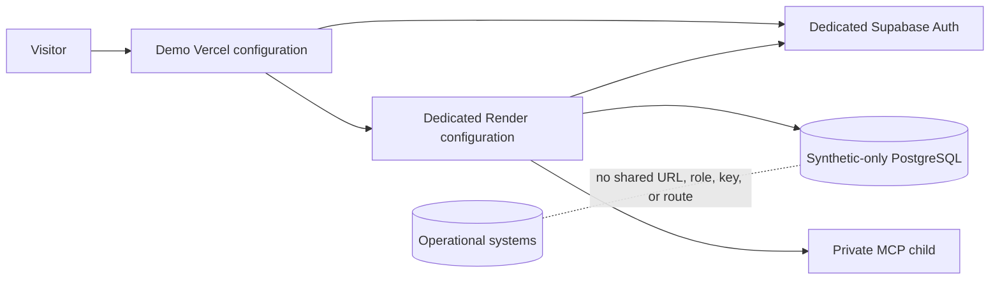

# Demo environment architecture and threat model

## Current state

AgentOS has two distinct demo mechanisms:

1. **Local development personas.** FastAPI issues an HTTP-only signed cookie for one of three fixed synthetic employee IDs. This route is disabled when `ENVIRONMENT=hosted` or authentication is not `development`.
2. **Hosted anonymous visitor design.** When `ENABLE_PUBLIC_DEMO=true`, a browser may obtain a legitimate anonymous Supabase JWT and request one of three fixed personas. `public_demo.py` accepts only a verified JWT with `is_anonymous=true`, creates a new `hosted_demo` tenant for the subject, and maps the subject in `auth_identities`.

The production project currently keeps anonymous sign-in disabled. Passwordless recruiter access therefore remains **blocked pending a separately approved cloud demo environment**.

## Target isolation

A separate database is insufficient if authentication, service credentials, or routing still reach another environment. The target therefore requires a separate Supabase project, separate backend environment variables, and a frontend configured only for that demo.

## Trust decisions

- The browser never receives a service-role key or account password.
- The persona request accepts an enum, not an arbitrary email, employee ID, tenant, or role.
- FastAPI verifies the Supabase signature/issuer/audience/expiry before reading `is_anonymous`.
- The server owns the mapping from persona to `E001`, `E010`, or `E050`.
- Each anonymous subject receives a separate tenant, so visitors do not share mutable records.
- Persona switching changes the server mapping and the UI clears active run/event state before loading the new scope.
- POST origin, request header, body size, rate limit, role, scope, approval, and idempotency checks remain active.

## Threat assessment

| Threat | Control | Residual risk / next control |
|---|---|---|
| Browser claims Manager/HR | Server database mapping; role field is not accepted | Compromised server/database remains privileged |
| Arbitrary account exchange | Fixed persona enum and anonymous-subject requirement | Keep endpoint disabled outside dedicated demo |
| One visitor alters another's records | Per-subject tenant | Add expiry/cleanup for abandoned tenants |
| Public write abuse | Request limit, isolated data, workflow rules | Add provider/WAF rate limits and monitoring before activation |
| Reset reaches production | Local/test + loopback + explicit flag + `local_demo` kind | Cloud reset needs a separate reviewed job, not this command |
| Leaked demo password | Passwordless anonymous flow avoids published credentials | Anonymous Auth must be restricted to demo project |
| Stale private UI data after switching | Active run/events cleared and scoped reload | Expand browser regression assertion for every cached panel |
| Manager/HR scraping synthetic corpus | Per-visitor data and rate limit | Limit session lifetime and bulk endpoints |

## Cloud prerequisites and approval gate

Do not enable hosted one-click access until the owner approves:

1. creating a separate Supabase project with synthetic records only;
2. enabling anonymous Auth in that project;
3. creating separate Render/Vercel demo configurations;
4. setting exact demo origins and keys in provider secret stores;
5. testing cross-visitor isolation, expiry, rate limits, and cleanup; and
6. documenting who may reset or rotate the demo environment.

No production service, authentication setting, database, or cloud resource was changed while preparing this design.
