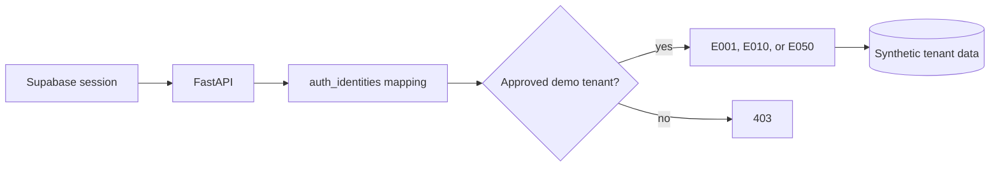

# Demo architecture and access model

AgentOS supports three synthetic access paths.

1. **Local development personas:** development-only signed sessions for `E001`, `E010`, and `E050`.
2. **Provisioned portfolio account:** a Supabase email/password subject mapped to the fixed seeded synthetic tenant. The visible selector changes only among the same three server-owned personas.
3. **Optional anonymous visitors:** when a dedicated synthetic project enables `ENABLE_PUBLIC_DEMO`, verified anonymous subjects receive isolated `hosted_demo` tenants.

The deployed portfolio uses the second path. Anonymous Auth is not required for its selector.

## Controls

- Persona input is an enum, never an arbitrary employee, tenant, or role.
- FastAPI verifies the JWT before reading its subject.
- The fixed seeded tenant is explicitly recognized as synthetic.
- Normal production tenants cannot switch personas.
- Role and tenant authorization continue on every protected endpoint.
- Active conversation state is cleared and scoped resources reload after switching.
- Mutations still require workflow confirmation and are not automatically retried.

## Optional anonymous environment

A public anonymous deployment should use a separate Supabase project, separate Render/Vercel configuration, synthetic-only data, rate limits, expiry/cleanup, and cross-visitor isolation tests. Do not enable it against an operational environment.
