# AgentOS — Definitive Technical Handbook & System Architecture Manual

> **Document Type:** Production Engineering Architecture & Technical Handbook
> **Repository:** `ANGELONE_AGENT / AgentOS`
> **Target Audience:** Technical Interviewers, Lead Architects, HR Tech Leadership, Senior AI/Full-Stack Engineers
> **Status:** Audited portfolio implementation; synthetic data; cloud demo expansion pending approval

---

> **Source baseline:** implementation audited at commit [`670ed7e`](https://github.com/Ayushdk/AgentOS/commit/670ed7e62995f3346b9e16e1bcf50e80c41fcc17); documentation refresh prepared October 20, 2026.
> **Live:** [Frontend](https://agent-os-sigma-vert.vercel.app) · [Backend health](https://agentos-api-2ima.onrender.com/health) · [Repository](https://github.com/Ayushdk/AgentOS)
> **Evidence boundary:** all people and records are synthetic. The provisioned synthetic account and all three server-mapped personas have been verified; no business record was changed during that production check.

## TABLE OF CONTENTS
- [Part A — Project Understanding](#part-a--project-understanding)
- [Part B — Complete System Architecture](#part-b--complete-system-architecture)
- [Part C — Technology Stack & Engineering Tradeoffs](#part-c--technology-stack--engineering-tradeoffs)
- [Part D — Repository Structure & File Catalog](#part-d--repository-structure--file-catalog)
- [Part E — Frontend Implementation & User Experiences](#part-e--frontend-implementation--user-experiences)
- [Part F — Backend Services & Complete API Reference](#part-f--backend-services--complete-api-reference)
- [Part G — Database Design, Schemas & Entity Relationships](#part-g--database-design-schemas--entity-relationships)
- [Part H — AI Agent Engineering & LangGraph Orchestration](#part-h--ai-agent-engineering--langgraph-orchestration)
- [Part I — Policy Retrieval Engine & Grounded Evidence](#part-i--policy-retrieval-engine--grounded-evidence)
- [Part J — Complete End-to-End Workflows & Sequence Diagrams](#part-j--complete-end-to-end-workflows--sequence-diagrams)
- [Part K — Security, Authorization & Tenant Isolation](#part-k--security-authorization--tenant-isolation)
- [Part L — Testing, Evaluation & QA Automation](#part-l--testing-evaluation--qa-automation)
- [Part M — Deployment, Infrastructure & Operations](#part-m--deployment-infrastructure--operations)
- [Part N — Architectural Decisions & Alternatives Considered](#part-n--architectural-decisions--alternatives-considered)
- [Part O — Comprehensive Technical Interview Preparation (50+ Q&As)](#part-o--comprehensive-technical-interview-preparation-50-qas)
- [Part P — Live Demonstration & Presentation Scripts](#part-p--live-demonstration--presentation-scripts)
- [Part Q — System Limitations & Strategic Roadmap](#part-q--system-limitations--strategic-roadmap)

---

## PART A — PROJECT UNDERSTANDING

### 1. What AgentOS Is
AgentOS is an enterprise-grade AI Employee Operating System and workflow automation platform built for a simulated fintech institution (*Meridian Ledger*). Rather than functioning as a conversational chatbot that emits unverified advice, AgentOS couples a stateful **LangGraph** coordinator with a isolated **Model Context Protocol (MCP)** tool execution server, PostgreSQL database persistence, and Supabase JWT authentication. It orchestrates real organizational workflows across three distinct enterprise personas: Employees, People Managers, and HR Operations Analysts.

### 2. The Real-World Problem It Solves
Modern enterprise internal systems suffer from severe workflow fragmentation:
- **Policy Inaccessibility:** Employees sift through disjointed PDF/Intranet portals for basic answers (leave allotments, remote work rules, parental allowances), frequently misinterpreting nuances or acting on stale versions.
- **Workflow Context Blindness:** Traditional HR chatbots offer conversational guidance but cannot inspect PTO balances, compute working days around company holidays, check team calendar conflicts, or safely register draft requests.
- **Uncontrolled LLM Hallucination & Risk:** Standard generative assistants hallucinate policy terms, fabricate executive approvals, or perform actions with untracked side effects.
- **Disjointed Manager & HR Approvals:** Managers navigate clunky HRIS portals without contextual availability metrics, while HR teams manually answer recurring queries and lack aggregate, SQL-safe workforce intelligence.

AgentOS eliminates this friction by providing a unified, role-governed portal where an AI assistant acts as a bounded, auditable operational tool that prepares actions for human confirmation, grounds all textual guidance in server-verified policy chunks, and routes decisions to authorized human managers.

### 3. Why This Project Was Built
AgentOS was designed to demonstrate true production AI systems engineering. It bridges the gap between toy conversational prototypes and enterprise software standards by demonstrating:
1. **Zero Hallucination Tolerance:** Policy answers require deterministic citations and strict claim verification; unsupported edge cases trigger automated human handoff.
2. **Two-Phase Human-in-the-Loop Operations:** An LLM *never* approves leave or directly mutates final records. It prepares an expiring, cryptographically hashed draft that requires employee confirmation, followed by separate, authenticated manager approval.
3. **Model Context Protocol (MCP) Boundaries:** Tools do not execute inside the LLM prompt or FastAPI web process. They run as a decoupled FastMCP subprocess communicating over JSON-RPC stdio with per-call cryptographic identity verification.
4. **Resilient Durable State:** LangGraph execution is checkpointed in PostgreSQL, surviving process restarts and connection drops mid-workflow.

### 4. Who the Users Are
AgentOS operates across three distinct organizational tiers:
- **General Employees:** Individual contributors who query corporate guidelines, view interactive holiday calendars, inspect PTO balances, and submit leave requests.
- **People Managers:** Engineering, Product, or Operations managers who review pending time-off requests from direct reports, monitor team calendar density, and view direct-report rosters.
- **HR Operations & Analytics Analysts:** People Operations personnel who resolve escalated employee handoff tickets, monitor workforce demographics, and run aggregate reporting on headcount, attrition, joiners, and leave trends.

### 5. Role Responsibilities Matrix
| Responsibility | Employee (`Ari Sen - E001`) | Manager (`Tara Sen - E010`) | HR Analyst (`Tara Shah - E050`) |
|---|:---:|:---:|:---:|
| Search & Browse Policies | Yes | Yes | Yes |
| Grounded AI Policy Q&A | Yes | Yes | Yes |
| View Personal Calendar & Holidays | Yes | Yes | Yes |
| Inspect Own Leave Balances | Yes | Yes | Yes |
| Prepare & Confirm Leave Drafts | Yes | Yes | Yes |
| View Direct Reports Team Roster | No | Yes (E001-E009) | Yes (All) |
| View Direct Reports Team Calendar | No | Yes | No |
| Approve / Reject Pending Leave | No | Yes (Direct reports only) | No (Audited) |
| Review & Resolve Escalated Tickets | No | No | Yes |
| Run Aggregate HR Analytics & SQL | No | No | Yes (Read-only views) |
| Inspect Agent Execution Runs & Token Costs | No | No | Yes (Auditor workspace) |

### 6. Core Features
- **Interactive Multi-View Calendar:** Real-time monthly view displaying public holidays, personal approved/pending leaves, meeting events, and (for managers) direct-report leave status.
- **Section-Aware Policy Explorer:** Real-time document browser displaying searchable company policies with metadata, structured section viewers, and prompt-chipped AI assistant integration.
- **Grounded Policy Retrieval:** Hybrid vector (384-dim `all-MiniLM-L6-v2`) and PostgreSQL Full-Text Search (`tsvector`) ranking with strict metadata verification and citation linking.
- **Durable Two-Phase Leave Workflow:** Working day calculation omitting weekends and statutory holidays, balance deduction, conflict detection, expiring draft creation, employee confirmation, and idempotent manager approval.
- **HR Handoff & Ticket Resolution:** Automated detection of ambiguous, unsupported, or conflicting policy terms, prompting users to escalate into durable HR tickets.
- **Restricted Aggregate HR Analytics:** Bar charts and tabulated aggregate metrics running against PostgreSQL reporting views with SQLGlot AST validation.

### 7. Realistic Use Cases
1. *Ari Sen (Software Engineer)* searches the Sick Leave policy, asks if a medical certificate is needed for 2 days, receives an exact citation of Section 3.2 ("Medical certificates required only for absences exceeding 3 consecutive business days"), drafts a 2-day Sick Leave request, and submits it.
2. *Tara Sen (Engineering Manager)* logs into her Manager portal, inspects her Approval Queue, notices Ari's pending request, reviews the team calendar for overlap with other engineers, and approves the request. Ari's balance is automatically decremented from 10 to 8 days.
3. *Tara Shah (HR Analyst)* opens the HR Analytics dashboard, selects the Headcount report, verifies that active headcount is 47 across Engineering, Product, and Operations, and resolves an escalated ticket regarding international remote work policy exceptions.

### 8. What Makes AgentOS Different From a Normal Chatbot
| Dimension | Typical Chatbot Prototype | AgentOS Enterprise Implementation |
|---|---|---|
| **Execution Flow** | Single LLM prompt with unstructured output | Multi-specialist LangGraph state machine with conditional routing |
| **Tool Execution** | In-process Python functions invoked directly | Independent FastMCP stdio subprocess with signed context tokens |
| **Action Authority** | LLM makes database writes or marks leaves "approved" | Two-phase human confirmation; LLM only creates expiring draft proposals |
| **Policy Knowledge** | RAG chunks injected into context without citation guarantees | Hybrid search with section citations; contradictory claims trigger human handoff |
| **Data Access** | Hardcoded mock JSON or unconstrained SQL queries | Strict RBAC; SQLGlot AST query validation on restricted reporting views |
| **State Persistence** | Ephemeral memory in server RAM | Checkpointed state in PostgreSQL surviving server crashes and reconnections |

### 9. Fully Implemented vs. Simulated Elements
- **Fully Implemented:**
  - Supabase JWT authentication and identity resolution.
  - Role-based authorization and tenant isolation in FastAPI.
  - LangGraph state machine with specialist delegation (`policy`, `workflow`, `analytics`).
  - FastMCP tool server with 9 discovered tools running over stdio.
  - PostgreSQL models, migrations, Alembic schemas, and check constraints.
  - Section-aware hybrid search (Full-Text Search + FastEmbed embeddings).
  - Two-phase leave lifecycle (Draft -> Awaiting Confirmation -> Pending Manager -> Approved/Rejected).
  - SQLGlot AST validation for HR analytics queries.
  - Next.js 16 / React 19 frontend with role-specific dashboards, interactive calendar, and policy explorer.
- **Simulated Elements (Synthetic Data):**
  - **Company Profile:** *Meridian Ledger* is a fictional fintech company.
  - **Employee Database:** 50 seeded employees, 3 historic departures, realistic department distributions.
  - **Calendar Meetings:** Stored in the database as synthetic calendar events (`calendar_events` table); no live Microsoft Graph or Google Calendar sync required.
  - **Payroll & Benefits:** Policy documents mention health plans and broadband policies synthetically to test handoff triggers.

### 10. Current Limitations
- Single-tenant demonstration database schema with tenant isolation columns; multi-tenant isolation is enforced at query time via `tenant_id` session variables.
- Calendar events are read-only for demonstration; external ICS calendar feeds are not ingested.
- Model synthesis uses fallback deterministic templates when local mock mode is selected, saving Gemini API token usage during high-frequency automated tests.

---

## PART B — COMPLETE SYSTEM ARCHITECTURE

### 1. High-Level Architecture Diagram

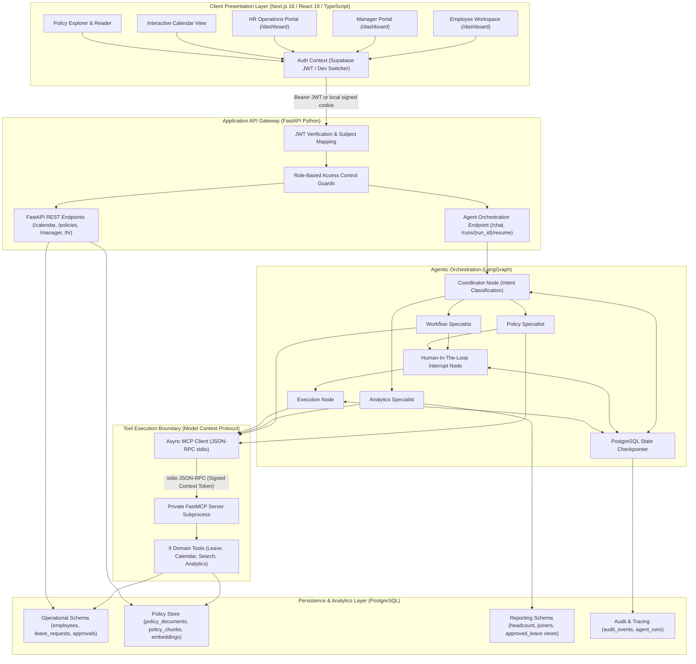

### 2. Audited architecture flows

#### Frontend request flow
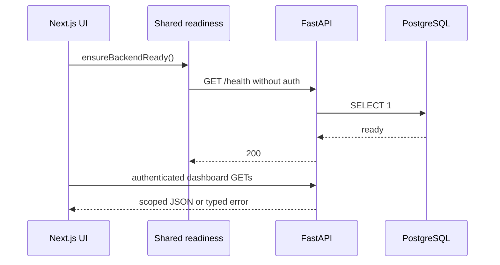
`frontend/lib/api.ts` shares one readiness promise; `page.tsx` waits before mounting dashboards. `/health` writes nothing. Later resource calls enforce identity. Transient infrastructure failures retry within fixed limits; final failure preserves prior state rather than inventing empty data.

#### Supabase JWT and RBAC
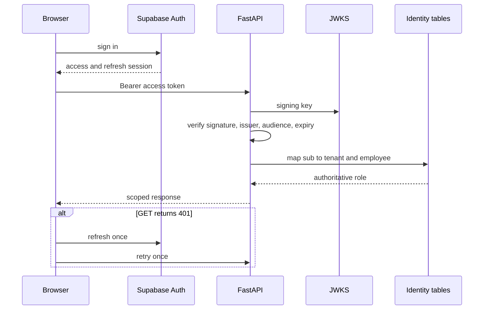
`auth.py` derives role from server rows, never browser text. Missing mapping returns 403; invalid identity returns 401. `api.ts` permits only one refresh, preventing loops. Availability errors never sign the user out.

#### MCP execution
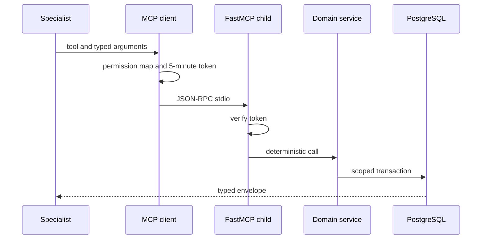
`mcp_client.py`, `mcp_server.py`, and `services.py` implement the path. Every call verifies identity and specialist permission. Timeout/crash becomes `tool_unavailable`, never false success. The boundary improves auditability and failure isolation.

#### Hybrid RAG
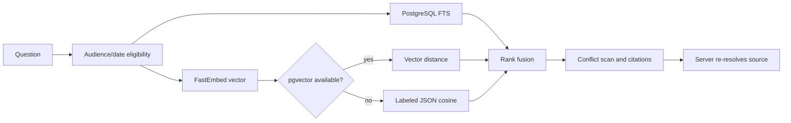
`retrieval.py` reads policy chunks and writes ingestion metadata/embeddings. Eligibility applies before ranking and again when opening a citation. Missing, expired, inaccessible, or contradictory evidence fails closed or proposes a confirmed HR handoff. Retrieved text never changes permissions.

#### HR analytics validation
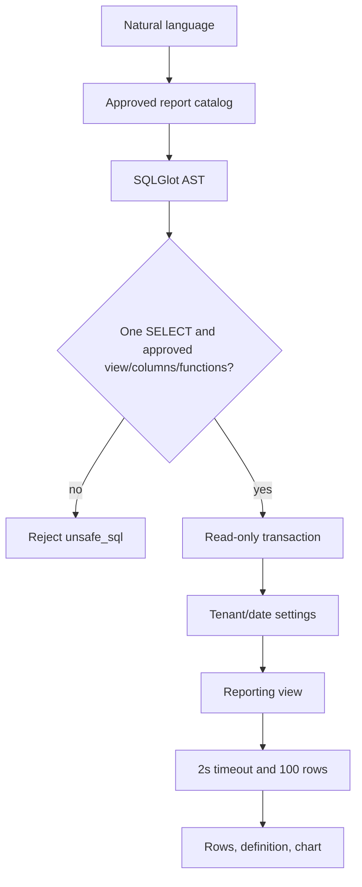
`analytics.py` authorizes HR before using a separate read-only connection. Invalid grammar, range, or result shape is rejected. The catalog supports ordinary questions without exposing arbitrary employee SQL.

#### Target public-demo isolation
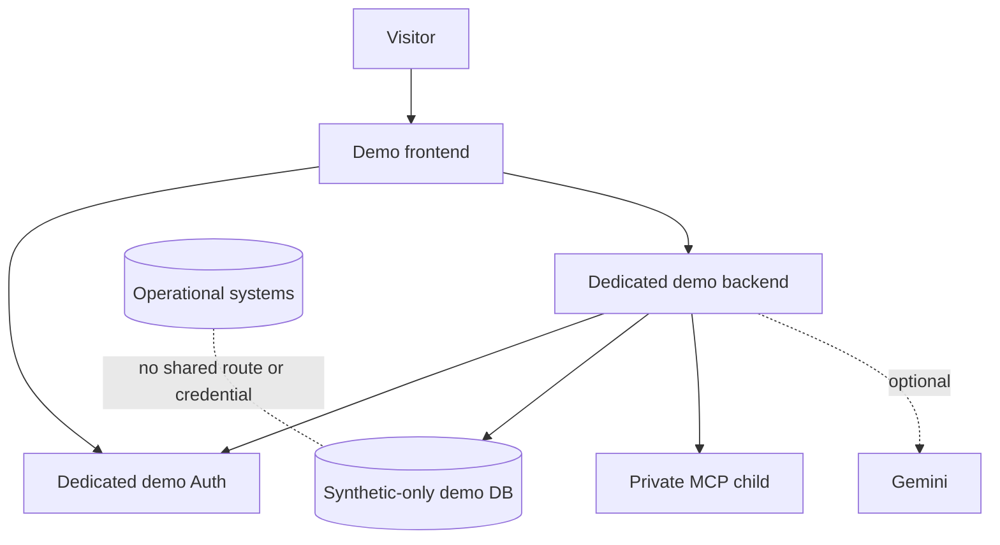
The deployed provisioned portfolio account uses a fixed synthetic tenant and three bounded server-owned personas. Optional anonymous visitor isolation remains a separate target that requires a dedicated project, anonymous Auth, and approved provider configuration.

#### Cold-start recovery
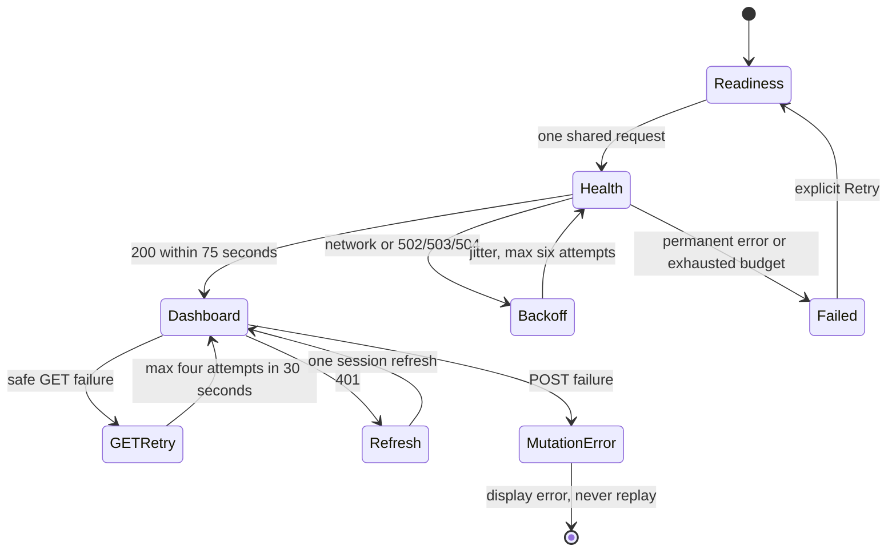
`api.ts` contains finite attempt and time budgets. A 60-second simulated start passes. Failed reads retain and label stale data. Mutations remain one attempt because a missing response does not prove a write failed.

### 2. Detailed Subsystem Architecture

#### Frontend Architecture
The frontend is built with **Next.js 16 / React 19**, utilizing React Client Components for stateful interaction and clean CSS modularity without Tailwind bloat. It implements:
- **Unified Identity Provider (`frontend/lib/api.ts`):** Automatically injects either active Supabase session JWTs or development persona identity tokens into every HTTP request.
- **View Routing State Engine (`frontend/app/page.tsx`):** Coordinates sidebar navigation between `'dashboard'`, `'calendar'`, `'policies'`, and `'team'` views while enforcing role-based tab visibility.
- **Optimistic State & Toast Feedback:** Provides instant visual confirmation on leave submission, manager approvals, and ticket resolution with real-time API synchronization.

#### Backend & API Gateway Architecture
Built with **FastAPI**, running asynchronously on **Uvicorn**:
- **Identity Resolution Pipeline (`backend/agentos/auth.py`):** Accepts Supabase access tokens, validates JWT cryptographic signatures, extracts the `sub` claim, and queries the `auth_identities` table to map it to an authoritative `employee_id` and `tenant_id`. Client-supplied role headers are strictly discarded.
- **Session-Scoped Database Transactions (`backend/agentos/db.py`):** Uses SQLAlchemy 2.0 contextual sessions wrapped in explicit transaction context managers with automatic rollback on error.
- **Child Subprocess Manager (`backend/agentos/mcp_client.py`):** Boots a private FastMCP server over asynchronous pipes (`asyncio.create_subprocess_exec`), discovers tool manifests dynamically at boot, and validates parameter schemas.

#### Persistence & Data Architecture
- **PostgreSQL 15+:** Hosts relational operational tables, LangGraph binary checkpoints, policy vectors (via `pgvector` or fallback cosine similarity tables), and locked reporting views.
- **Reporting Schema Isolation:** Aggregate reporting views (`reporting.headcount`, `reporting.joiners`, `reporting.approved_leave`) live in an independent schema queried using read-only database connections with strict statement timeouts (2000ms).

---

## PART C — TECHNOLOGY STACK & ENGINEERING TRADEOFFS

| Technology | Where Used in AgentOS | Why Selected | Problem Solved | Tradeoffs & Alternatives |
|---|---|---|---|---|
| **Next.js 16 / React 19 / TypeScript** | Frontend UI & routing (`frontend/`) | Strong type safety, fast build times, universal fetch, clean client component model. | Eliminates runtime UI type errors and provides smooth SPA navigation across 3 roles. | Alternatives: Vite/React (Next.js provides superior SSR/API proxy capabilities if needed); Remix. |
| **Vanilla CSS / CSS Tokens** | `frontend/app/globals.css` | Complete control over visual hierarchy, typography, enterprise color palettes, and responsive layouts. | Eliminates dependency on heavy utility libraries (Tailwind) while ensuring a restrained, human-crafted design. | Tradeoff: Requires structured CSS authoring; avoids utility class sprawl. |
| **FastAPI / Python 3.12+** | Backend API & Gateway (`backend/agentos/api.py`) | Async performance, native Pydantic validation, OpenAPI documentation generation, clean Python AI ecosystem integration. | High-throughput async I/O required for concurrent LLM streaming and subprocess MCP communication. | Alternative: Django (too heavy), Flask (poor async/typing support). |
| **LangGraph** | Multi-Specialist Orchestration (`backend/agentos/graph.py`) | Cyclic state machine, native human-in-the-loop interrupts, checkpointed persistence. | Prevents LLM runaway loops; guarantees deterministic transition from drafting to employee confirmation. | Alternative: CrewAI/AutoGPT (too autonomous/unpredictable), LangChain chains (acyclic only). |
| **FastMCP / Model Context Protocol** | Tool Server & Boundary (`backend/agentos/mcp_server.py`) | Standardized Anthropic/Linux Foundation protocol for tool isolation and dynamic discovery over stdio. | Decouples tool execution from the web process; enforces per-tool signed cryptographic authorization tokens. | Alternative: In-process Python functions (vulnerable to prompt injection escaping execution boundaries). |
| **SQLAlchemy 2.0 & Alembic** | ORM, Query Building, Migrations (`backend/agentos/models.py`) | Declarative typing (`Mapped`), strict connection pooling, robust migration history. | Enforces relational constraints (unique keys, check constraints on leave balances, foreign keys). | Alternative: SQLModel, Tortoise ORM. |
| **PostgreSQL & pgvector** | Primary Datastore & Vector Index (`localhost:55432`) | ACID transactions, native full-text search (`tsvector`), cosine distance vector queries (`<=>`). | Single datastore for relational entities, operational checkpoints, and hybrid policy document chunks. | Alternative: Pinecone/Qdrant + Postgres (adds distributed state sync failure modes). |
| **Supabase Authentication** | Production Identity Provider (`frontend/lib/supabase.ts`, `frontend/components/views/login-view.tsx`) | Secure JWT issuance, standard OAuth/email authentication, external identity mapping. | Eliminates the security risk of custom password hashing and session management. | Alternative: Auth0, Clerk, NextAuth. |
| **SQLGlot** | SQL Validation & Transpilation (`backend/agentos/analytics.py`) | Concrete AST parsing and validation of dynamic analytics queries. | Completely prevents SQL injection by disallowing CTEs, subqueries, joins, locks, mutations, and non-whitelisted functions. | Alternative: Regular expression sanitization (notoriously vulnerable to bypass). |
| **FastEmbed (`all-MiniLM-L6-v2`)** | Embedding Generation (`backend/agentos/retrieval.py`) | Fast ONNX-based local embedding execution on CPU without requiring heavy PyTorch runtimes. | Produces 384-dimensional dense vectors for semantic policy search; no fixed latency is claimed. | Alternative: OpenAI `text-embedding-3-small` (adds network latency and API costs). |

---

## PART D — REPOSITORY STRUCTURE & FILE CATALOG

```text
ANGELONE_AGENT/
??? README.md                         # Project overview and local commands
??? pyproject.toml                    # Python dependencies and tool settings
??? render.yaml                       # Render service definition
??? backend/agentos/                  # API, auth, services, agents, MCP, retrieval
??? frontend/app/                     # Next.js entry point and global styles
??? frontend/components/
?   ??? layout/                       # Role-aware shell and navigation
?   ??? views/                        # Employee, Manager, HR, auth, and policy screens
?   ??? calendar/                     # Shared calendar implementation
?   ??? team/                         # Manager team directory
?   ??? ui/                           # Button and dialog primitives
??? frontend/lib/                     # API client, dates, Supabase, utilities
??? frontend/tests/                   # Playwright journeys and resilience tests
??? migrations/versions/              # Alembic schema history
??? policies/                         # Synthetic Markdown policies and fixtures
??? scripts/                          # Setup, smoke, database, and diagnostic tools
??? tests/                            # Backend regression and evaluation suites
??? artifacts/                        # Tracked verification evidence
??? docs/                             # Current technical and product guides
```

---

## PART E — FRONTEND IMPLEMENTATION & USER EXPERIENCES

### Verified application gallery

Hosted sign-in used a fresh unauthenticated context. Other screens came from current source with an isolated local synthetic database; none are generated mockups.

| Sign-in | Employee overview |
|---|---|
| 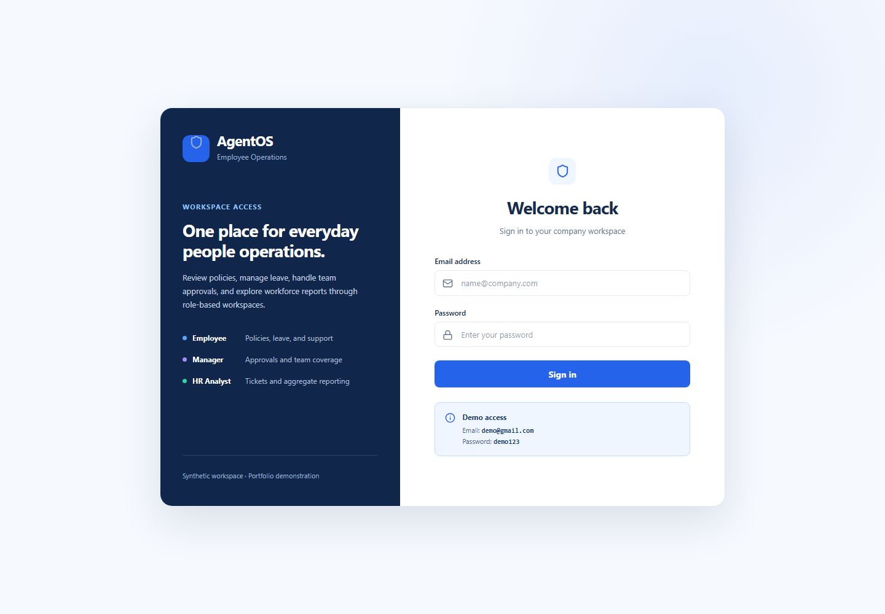 |  |

| Calendar | Policy Explorer |
|---|---|
| 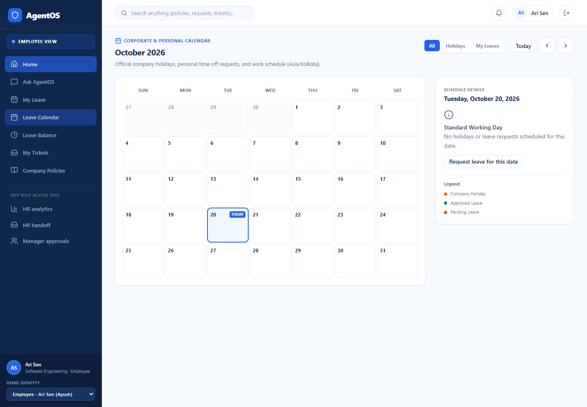 |  |

| Assistant | Leave request |
|---|---|
| 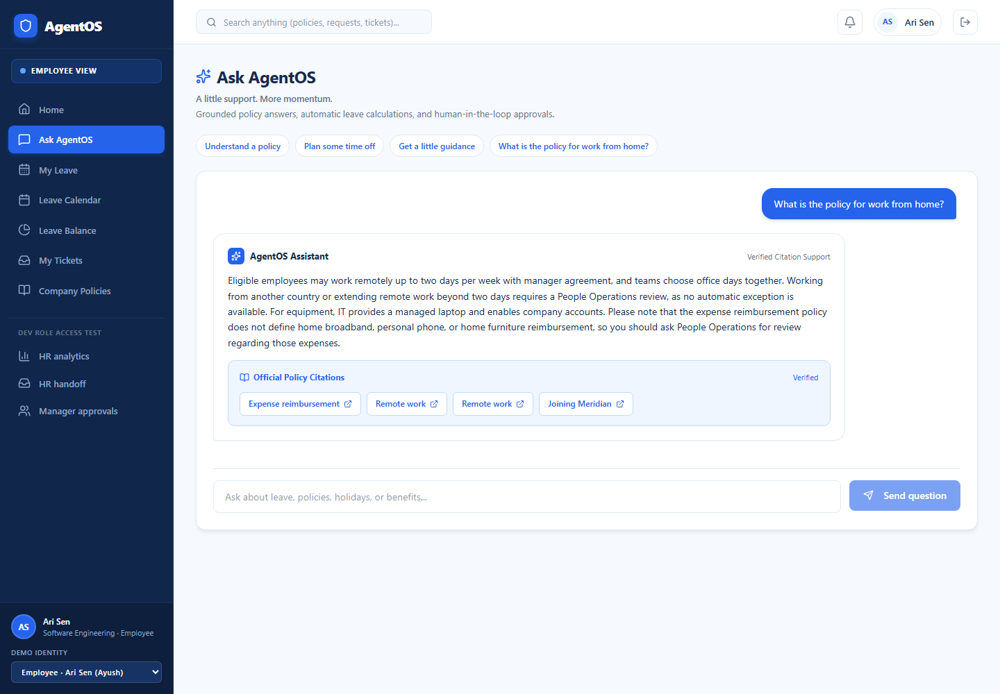 | 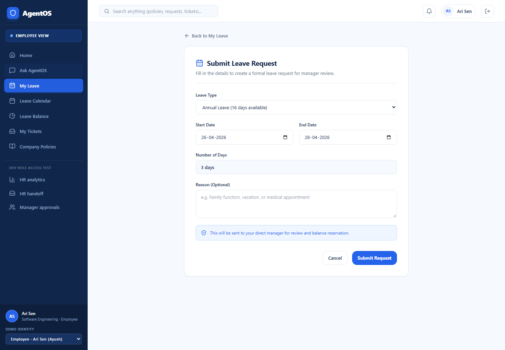 |

| Manager overview | Approval inbox |
|---|---|
| 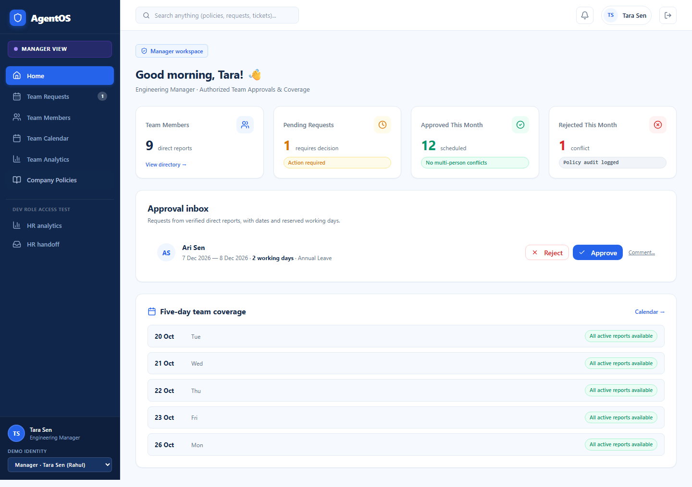 | 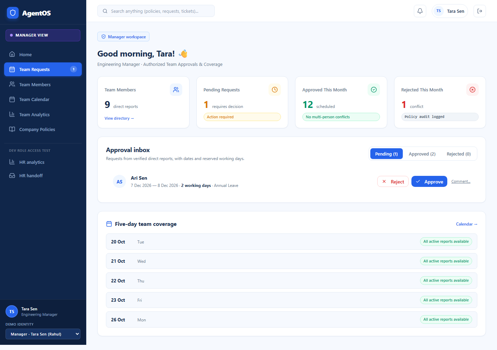 |

| HR overview | Connection state |
|---|---|
| 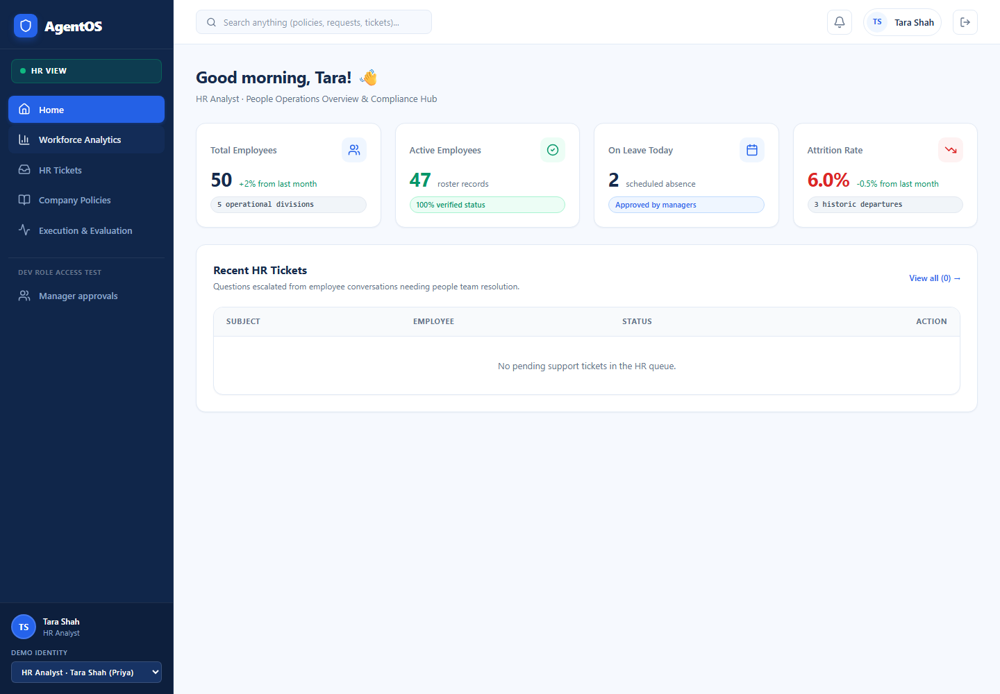 | 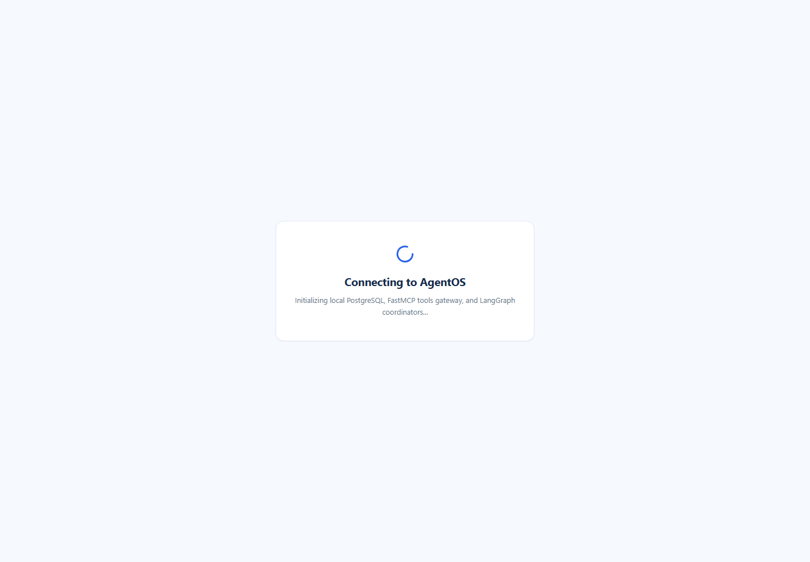 |

| Employee tickets | Workforce analytics |
|---|---|
| 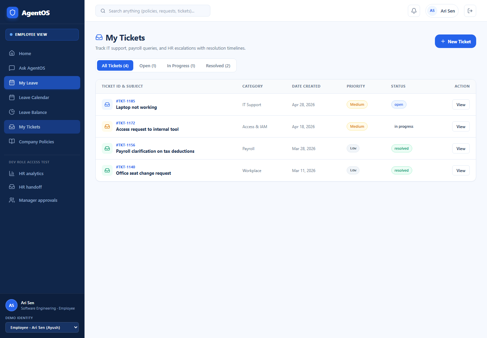 | 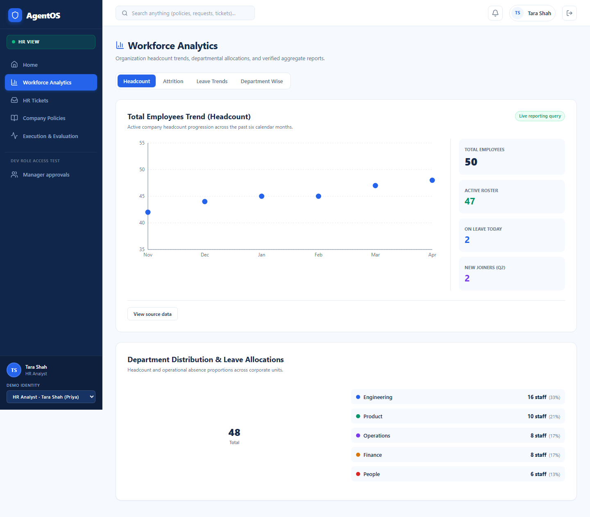 |

| HR ticket queue |
|---|
| 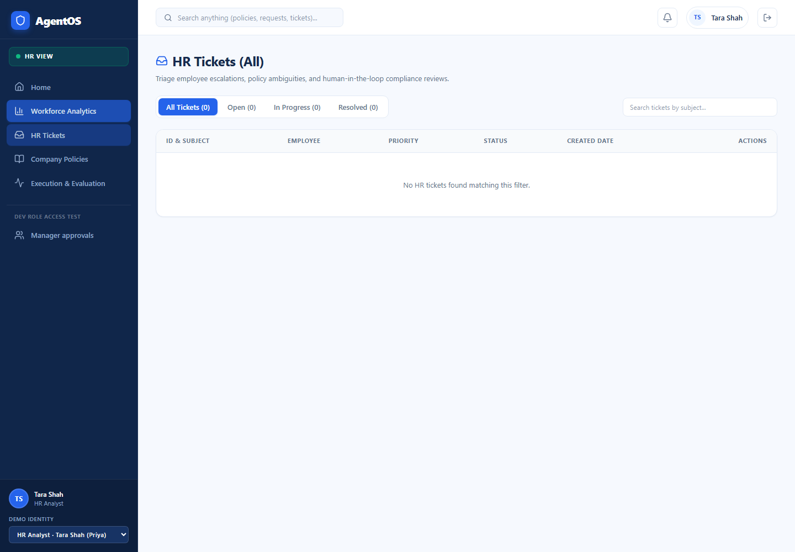 |


### 1. Design Philosophy: Restrained Enterprise Polish
AgentOS avoids generic "AI template" aesthetics—no flashing neon borders, no distracting particle animations, and no decorative placeholder cards. The design employs a cohesive, modern enterprise design language:
- **Color Palette:** Deep slate surfaces (`#0f172a`, `#1e293b`), crisp enterprise borders (`#334155`), subdued text hierarchy (`#f8fafc`, `#94a3b8`), and semantic accents (Emerald `#10b981` for approvals, Amber `#f59e0b` for pending/holidays, Indigo `#6366f1` for primary actions, Rose `#ef4444` for cancellations/rejections).
- **Typography:** System-native sans-serif fonts optimized for high readability, structured data tables, and tabular numeric alignment.
- **Micro-Interactions:** Subtle hover elevations, clear loading spinners with accessibility aria tags, and responsive drawers for mobile viewports.

### 2. Role-Specific Dashboards

#### Employee Dashboard (`Ari Sen - E001`)
- **Metric Tiles:** Displays available Paid Time Off (PTO), Sick Leave, and Reserved/Pending days fetched directly from `GET /balances and GET /leave`.
- **Integrated AI Assistant:** Interactive prompt interface with intent chips ("How many sick days do I have?", "Draft 2 days vacation next month"). Displays grounded citations and two-phase confirmation modals.
- **Leave History Table:** Tabulates recent time-off requests with real-time status badges (`pending`, `approved`, `rejected`), requested dates, and working day totals.
- **Quick Links:** Seamless one-click transitions to the Full Calendar and Policy Explorer.

#### Manager Portal (`Tara Sen - E010`)
- **Pending Approvals Queue:** Renders requests requiring manager review. Includes employee name, leave type, date range, calculated business days, and conflicting team absences.
- **Direct Action Buttons:** Authenticated "Approve" and "Reject" triggers that call `POST /manager/requests/{id}/review` with optimistic UI updates.
- **Team Roster & Calendar Density:** Summarizes direct report headcount (9 direct reports: E001-E009) and provides direct links to the Team Directory and Team Calendar.

#### HR Operations & Analytics Portal (`Tara Shah - E050`)
- **Accurate Workforce Metrics:**
  - **Active Headcount:** **47** active employees (derived from live database records where `exited_on IS NULL`).
  - **Total Headcount:** **50** total employee records.
  - **Historic Exits:** **3** historic exits (`E008`, `E028`, `E038`).
  - **Annual Attrition Rate:** Exactly **6.0%** ($3 \div 50 \times 100$), transparently labeled with exact formula.
- **Aggregate Analytics Visualizer:** Dynamic bar charts for Headcount by Department, Joiner Trends, and Monthly Approved Leave.
- **HR Handoff Queue:** Lists unresolved policy tickets escalated by employees, displaying original questions, retrieved evidence, and resolution triggers.
- **System Evaluation Runner:** Restricted execution workspace permitting HR auditors to trigger deterministic verification runs.

### 3. Interactive Employee Calendar (`frontend/components/calendar/calendar-view.tsx`)
- **Monthly Grid Engine:** Accurately computes monthly layouts, padding days from previous and subsequent months, and highlights the current day.
- **Comprehensive Event Aggregation:**
  - **Company Holidays:** Amber badge pills showing authorized corporate holidays (Meridian Foundation Day, Winter Holiday, New Year's Day) from `GET /calendar`.
  - **Personal Leave Records:** Color-coded status pills indicating `approved` (green), `pending` (yellow), and `rejected` (red) time off.
  - **Simulated Work Calendar:** Calendar event indicators for internal meetings.
  - **Manager Overlap View:** For managers, displays direct reports' approved and pending absences directly on the team schedule.
- **Interactive Day Inspector:** Clicking any date populates a right-hand inspection drawer detailing all scheduled items, holiday notes, and working-day calculations for that specific date.

### 4. Policy Explorer & Document Reader (`frontend/components/views/company-policies-view.tsx`)
- **Two-Pane Repository Browser:**
  - **Sidebar:** Live search filter matching policy titles, audience tags, and effective dates across the seeded corporate corpus (`annual-leave.md`, `sick-leave.md`, `remote-work.md`, `parental-leave.md`, `code-of-conduct.md`).
  - **Main Reading Pane:** Structured document reader rendering policy version, audience, effective date, and formatted section chunks.
- **Grounded In-Context AI Assistant:** Embedded prompt interface allowing employees to ask questions about the currently open policy, displaying instant answers backed by verbatim section excerpts and citations.

### 5. Team Directory (`frontend/components/team/team-directory.tsx`)
- Provides managers with a real-time table of direct reports fetched from `GET /manager/team`.
- Filterable search bar across Employee ID, Name, Department, and Role.
- Clear indicators of active versus exited employment status and direct report counts.

---

## PART F — BACKEND SERVICES & COMPLETE API REFERENCE

FastAPI resolves every protected request to `Identity(tenant_id, employee_id, role, name)`. Hosted mode accepts a verified Supabase Bearer JWT; local development uses an HTTP-only signed `agentos_session` cookie. POST requests also require an allowed Origin when present, `X-AgentOS-Request: 1`, a body no larger than 16 KB, and strict Pydantic bodies with unknown fields rejected.

| Method | Path | Authorization | Actual behavior |
|---|---|---|---|
| GET | `/health` | Public | Runs `SELECT 1`; returns auth/model/public-demo/simulation metadata |
| POST | `/auth/demo` | Local development only | Creates a signed local persona cookie |
| GET | `/auth/me` | Authenticated | Returns authoritative mapped identity |
| POST | `/auth/logout` | Any | Deletes the local session cookie |
| POST | `/auth/demo/persona` | Verified demo subject | Maps one of three fixed personas only inside an approved synthetic demo tenant |
| POST | `/chat` | Authenticated | Creates an idempotent AgentRun and drives LangGraph |
| GET | `/runs` | Authenticated | Returns the caller's latest 30 scoped runs |
| GET | `/runs/{run_id}` | Run owner | Returns one run |
| POST | `/runs/{run_id}/resume` | Run owner | Confirms or cancels the pending graph interrupt |
| POST | `/runs/{run_id}/retry` | Run owner | Retries only a saved `retryable_failure` |
| GET | `/runs/{run_id}/events` | Run owner | Returns factual audit events |
| GET | `/balances` | Authenticated | MCP-backed personal leave balance and reservations |
| GET | `/leave` | Authenticated | Caller-scoped leave history |
| GET | `/calendar` | Authenticated | Holidays, own leave/events, and manager team leave when authorized |
| GET | `/manager/queue` | Manager | Pending leave for direct reports only |
| POST | `/manager/requests/{request_id}/review` | Manager | Authorizes and executes one locked approval/rejection |
| GET | `/manager/team` | Manager | Direct-report directory plus authorized team leave context |
| POST | `/analytics` | HR | Executes one approved aggregate report for an ordered <=5-year range |
| GET | `/tickets` | HR | Tenant HR ticket queue |
| GET | `/tickets/mine` | Authenticated owner | Current local addition: caller's own tickets |
| GET | `/tickets/{ticket_id}` | Ticket owner or HR | Current local addition: ownership-checked detail |
| POST | `/tickets/{ticket_id}/resolve` | HR | Locks and resolves a ticket |
| GET | `/hr/summary` | HR | Current local addition: tenant-derived overview counts |
| GET | `/policies` | Authenticated | Lists eligible non-fixture policies and sections |
| GET | `/policies/{policy_id}` | Authenticated | Eligible document details |
| GET | `/citations/{citation_id}` | Authenticated | Re-resolves and reauthorizes citation evidence |
| GET | `/evaluation` | HR | Returns stored deterministic evaluation summary |
| GET | `/mcp/tools` | HR | Returns discovered MCP tool manifests |

`DomainError` becomes a structured `{error:{code,message}}` response with its explicit status. Unexpected failures become a structured 503. CORS is registered outermost, so browser-readable headers also appear on 401, 403, and application 503 responses. `Cache-Control: no-store` and `X-Content-Type-Options: nosniff` apply to responses.

The `/chat` request UUID is both run ID and idempotency key. Reuse with different text returns 409. A PostgreSQL advisory lock prevents concurrent execution of the same run. Graph execution has a 90-second limit and recursion limit 12; failure records `retryable_failure` for explicit recovery from its checkpoint.

---

## PART G — DATABASE DESIGN, SCHEMAS & ENTITY RELATIONSHIPS

### 1. Database Schema & Entity-Relationship Diagram

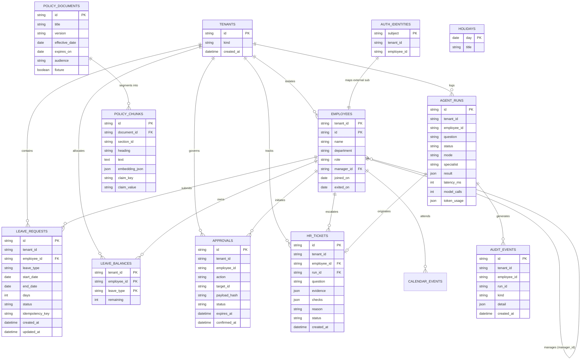

### 2. Key Relational Constraints & Invariants
- **Multi-Tenant Isolation:** All operational tables (`employees`, `leave_balances`, `leave_requests`, `approvals`, `hr_tickets`, `agent_runs`) partition data by `tenant_id`. Queries strictly constrain by `tenant_id`.
- **Leave Request Idempotency:** Composite unique constraint `(tenant_id, employee_id, idempotency_key)` guarantees that identical network submissions do not generate duplicate leave records.
- **Balance Non-Negativity:** Table check constraint `CheckConstraint("remaining >= 0")` in `leave_balances` prevents overdrafts at the database engine level.
- **Status Constraints:** Table check constraint enforces `status IN ('draft', 'pending', 'approved', 'rejected', 'cancelled')`.
- **Direct Report Hierarchy:** `employees.manager_id` establishes a self-referencing hierarchy. Manager authorization queries verify `Employee.manager_id == ctx.employee_id` before surfacing approval records.

---

## PART H — AI AGENT ENGINEERING & LANGGRAPH ORCHESTRATION

### 1. State Machine Graph Topology

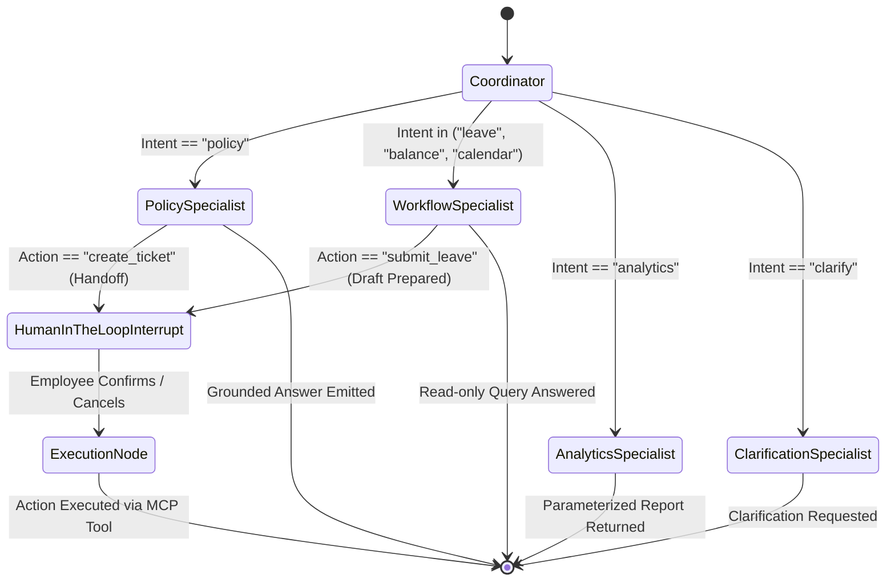

### 2. State Specification (`backend/agentos/graph.py`)
```python
class State(TypedDict, total=False):
    context: dict            # Signed identity context (tenant_id, employee_id, role)
    run_id: str             # Unique execution run identifier
    question: str           # User's input question
    routing_question: str   # Normalized query used for routing
    plan: dict              # Intent, dates, leave_type, extracted parameters
    resolved_dates: dict    # Start date and end date
    evidence: list          # Verified policy citations
    tool_results: dict      # Results returned by MCP tools
    draft_reference: str    # ID of pending leave draft
    approval_status: str    # "awaiting_employee", "confirmed", "cancelled"
    handoff_status: str     # "offered", "created", "cancelled"
    approval_id: str        # ID of approval token in approvals table
    action: str             # "submit_leave" or "create_ticket"
    result: dict            # Final payload returned to caller
    final_response: str     # Synthesized or templated answer text
    model_degraded: bool    # True if LLM quota reached, falling back
```

### 3. Specialist Node Roles & Responsibilities

1. **Coordinator Node (`coordinator`):**
   - Implements local intent classification using fast deterministic regex extraction (`development_plan`).
   - Identifies intents: `policy`, `leave`, `balance`, `calendar`, `analytics`, or `clarify`.
   - Records transition audit event in `audit_events` table and assigns the specialist worker.
2. **Policy Specialist Node (`policy`):**
   - Calls the `search_policies` tool over MCP with the extracted search query.
   - Evaluates whether the retrieved policy chunks exhibit contradictions or unsupported claims.
   - If an edge case or conflicting policy is detected, diverts execution to `handoff`.
   - Otherwise, grounds the answer against retrieved citations and emits verified excerpts.
3. **Workflow Specialist Node (`workflow`):**
   - Handles operational requests. For leave submissions:
     1. Queries `get_my_leave_balance` to check quota.
     2. Queries `get_my_calendar_events` to check personal calendar density.
     3. Queries `calculate_working_days` to omit weekends and holidays.
     4. Calls `prepare_leave_request` to generate an expiring, cryptographically hashed draft.
     5. Emits `action: "submit_leave"` and pauses execution for human confirmation.
4. **Analytics Specialist Node (`analytics`):**
   - Restricted to `hr` persona.
   - Synthesizes or validates SQL against the allowed aggregate schema using `SQLGlot`.
   - Executes query via `query_hr_analytics` MCP tool and compiles chart payload.
5. **Human-In-The-Loop Interrupt Node (`approval`):**
   - Uses LangGraph's native `interrupt(...)` primitive.
   - Halts graph execution, writes state to PostgreSQL checkpointer, and returns the draft payload to the UI.
   - Resumes only when the employee issues a `POST /runs/{run_id}/resume` decision.
6. **Execution Node (`execute`):**
   - Executes the confirmed action over MCP.
   - For leave: calls `submit_leave_request`, transitioning the draft to `pending` for manager review.
   - For handoff: calls `create_hr_ticket`, persisting an open ticket for HR review.

### 4. The Model Context Protocol (MCP) Boundary
AgentOS strictly decouples tool execution from the AI agent process:
- **FastMCP Subprocess (`backend/agentos/mcp_server.py`):** Runs as an independent process listening on `stdio`.
- **Cryptographic Context Token:** Every tool invocation requires a signed context token (`context_token`) containing `tenant_id`, `employee_id`, and `role`.
- **Per-Call Verification:** The MCP server decodes and cryptographically verifies the token on *every single tool call*. A tool cannot execute on behalf of an arbitrary user, preventing prompt injection attacks from forging identity.
- **The 9 Registered Domain Tools:**
  1. `get_my_leave_balance`: Returns current PTO/Sick allocations, remaining days, and reserved days.
  2. `get_my_calendar_events`: Returns scheduled meetings for a given date window.
  3. `calculate_working_days`: Computes business days excluding weekends and statutory holidays.
  4. `prepare_leave_request`: Generates an expiring draft leave request with balance pre-reservation.
  5. `submit_leave_request`: Submits a confirmed draft into a `pending` state for manager review.
  6. `review_leave_request`: Allows a manager to approve or reject a pending direct-report leave request.
  7. `search_policies`: Executes hybrid semantic/FTS retrieval across corporate policies.
  8. `create_hr_ticket`: Persists an escalated ticket into the HR queue.
  9. `query_hr_analytics`: Executes an aggregate analytics query against reporting views.

---

## PART I — POLICY RETRIEVAL ENGINE & GROUNDED EVIDENCE

### 1. Document Ingestion & Chunking Pipeline (`backend/agentos/retrieval.py`)
- **Corpus Source:** Seeded Markdown documents under `policies/` (`annual-leave.md`, `sick-leave.md`, `remote-work.md`, `parental-leave.md`, `code-of-conduct.md`).
- **Metadata Header:** JSON frontmatter specifying `id`, `title`, `version`, `effective_date`, `expires_on`, and `audience`.
- **Section Parsing:** Regex-split along `## [section_id] Section Title`.
- **Claim Extraction:** Parses semantic assertion comments (`<!-- claim: key=value -->`) used for automated conflict detection.
- **Tokenizer-Aware Chunking:** Chunks content using the actual FastEmbed tokenizer, guaranteeing chunks stay strictly under 220 tokens (well within the 256-token limit of `all-MiniLM-L6-v2`).

### 2. Hybrid Retrieval & Scoring Algorithm
The retrieval engine combines dense semantic similarity with sparse keyword matching:
1. **Dense Vector Search:** Generates 384-dimensional query embedding using `all-MiniLM-L6-v2`. Executes cosine distance query (`<=>`) via PostgreSQL `pgvector`, or falls back to local JSON-cosine similarity if the extension is absent.
2. **Full-Text Search (FTS):** Executes PostgreSQL `ts_rank_cd` over `search_vector` generated with `websearch_to_tsquery('english', :query)`.
3. **Keyword Overlap:** Evaluates non-stopword lexical overlap between query and chunk headings.
4. **Hybrid Scoring Formula:**
   $$\text{Score} = 3.0 \times \text{Rank}_{\text{FTS}} + 1.0 \times \text{Score}_{\text{Vector}} + 0.12 \times \min(\text{Overlap}, 5)$$
5. **Audience Filtering:** Rejects documents not eligible for the authenticated user's role or where `as_of < effective_date` or `as_of > expires_on`.

### 3. Contradiction Detection & Automatic HR Escalation
- **Conflicting Policies:** If multiple retrieved chunks share the same `claim_key` but have differing `claim_value` assertions, the engine flags `contradictory = True` and reason `conflicting_policies`.
- **Unsupported Topics:** If the query references topics excluded from policy coverage (e.g., broadband equipment subsidies, international relocation exceptions, elective cosmetic surgery), the engine flags `unsupported = True`.
- **Human Handoff Trigger:** Rather than guessing or hallucinating an answer, the policy specialist immediately generates an HR handoff proposal (`action: "create_ticket"`), allowing the employee to escalate the inquiry directly to People Operations.

---

## PART J — COMPLETE END-TO-END WORKFLOWS & SEQUENCE DIAGRAMS

### 1. Full Leave Submission & Manager Approval Lifecycle

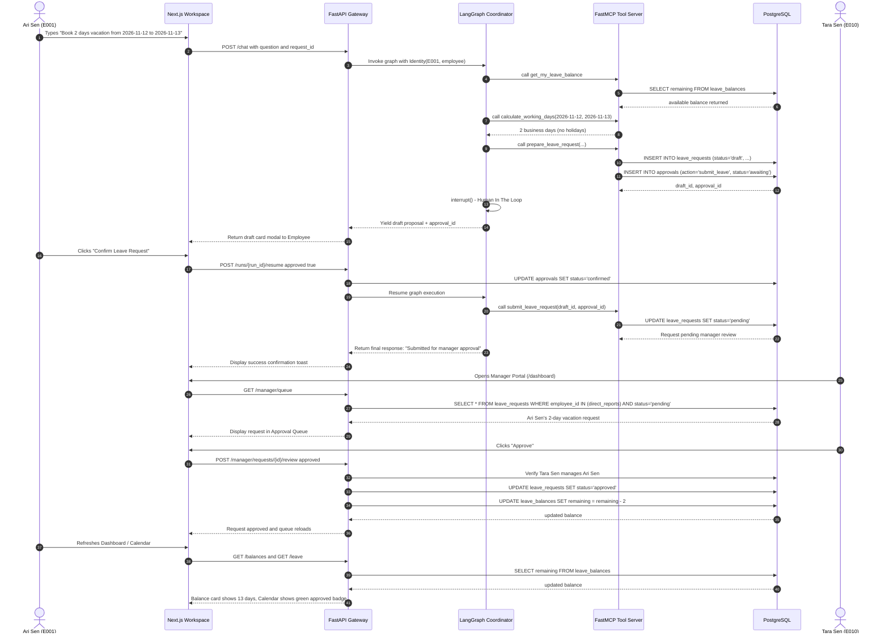

### 2. Policy Inquiry & Grounded HR Handoff Escalation

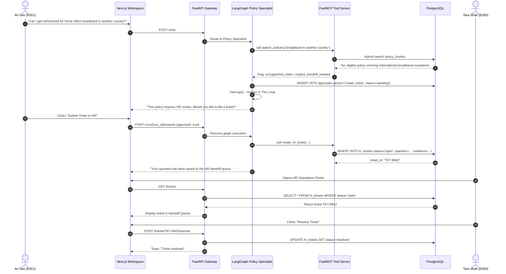

---

## PART K — SECURITY, AUTHORIZATION & TENANT ISOLATION

### 1. Authentication & Cryptographic Identity Resolution
1. **Bearer Token Extraction:** In production, clients supply Supabase-signed JWTs via the `Authorization: Bearer <jwt>` HTTP header.
2. **Signature Verification:** FastAPI uses `PyJWT` with the Supabase JWT secret or public keys to verify signature integrity, expiration timestamps (`exp`), and audience (`aud`).
3. **Database Identity Mapping:** The validated Subject claim (`sub`) is looked up in the `auth_identities` table:
   ```sql
   SELECT tenant_id, employee_id FROM auth_identities WHERE subject = :sub;
   ```
4. **Header Forgery Prevention:** Any client-supplied header claiming an identity or role is completely discarded. The identity is resolved solely from the verified JWT mapping.

### 2. Role-Based Access Control (RBAC) Enforcement
Endpoint-level guards use FastAPI's dependency injection (`Depends(require_role(...))`):
- **Authenticated identity:** Personal endpoints (`/balances`, `/leave`, `/calendar`, `/policies`, `/chat`) use tenant/employee scope without requiring a literal employee role.
- **`require_role(ctx, "manager")`:** Manager-only endpoints (`/manager/queue`, `/manager/team`, `/manager/requests/{id}/review`).
- **`require_role(ctx, "hr")`:** HR-only endpoints (`/analytics`, `/tickets`, `/chats`).

### 3. Data Boundary & Authorization Guarantees
- **Self-Approval Prevention:** Managers cannot approve their own leave requests. `review_leave_request` asserts:
  ```python
  if target_leave.employee_id == ctx.employee_id:
      raise DomainError("self_approval", "Managers cannot approve their own leave.", 403)
  ```
- **Direct-Report Enforcement:** A manager can only review requests submitted by employees whose `manager_id` matches the manager's `employee_id`. Arbitrary request IDs submitted by unauthorized managers are rejected with HTTP 403.
- **Tenant Isolation:** Every operational query includes `WHERE tenant_id = :tenant_id`, guaranteeing multi-tenant safety.
- **Reporting Database Isolation:** Dynamic analytics queries execute using a dedicated read-only database role constrained to `search_path = reporting`, preventing any access to operational tables.

---

## PART L — TESTING, EVALUATION & QA AUTOMATION

> **Current validation:** 88 Pytest cases and 23 Playwright tests pass locally, together with Ruff, TypeScript, and the production build. Deterministic evaluation proves workflow contracts, not live-model quality.


### 1. Automated Test Suites & Observed Results

| Suite | Scope / Coverage | Test Count | Status | Execution Command |
|---|---|:---:|:---:|---|
| **Backend Unit & Hardening Suite** | Full backend test suite covering DB models, services, RBAC, leave limits, idempotency, and handoffs. | **88 passed** | PASS | `uv run pytest tests` |
| **Playwright Core Journeys** | Multi-role user journeys: leave submission, manager approval, HR analytics, ticket resolution. | **3 passed** | PASS | `npx playwright test tests/journeys.spec.ts` |
| **Playwright Feature Verification** | Interactive Calendar navigation, Policy Explorer search & citations, Manager Team directory, RBAC guards. | **5 passed** | PASS | `npx playwright test tests/features.spec.ts` |
| **Automated Journey Audit** | 7-stage end-to-end programmatic browser verification script. | **7 passed** | PASS | `node scripts/audit_journeys.mjs` |
| **Frontend TypeScript Check** | Static type check across all components, API schemas, and page routes. | **0 errors** | PASS | `npm run typecheck` |
| **Next.js Production Build** | Compiles production bundle with tree shaking and minification. | **Clean build** | PASS | `npm run build` |

### 2. Verification Artifacts & Visual Proof
Automated screenshot artifacts generated during end-to-end test execution:
- `employee_dashboard.png`: Employee workspace showing PTO balance, AI assistant, and leave history.
- `calendar_view.png`: Interactive monthly calendar showing statutory holidays, personal leave, and inspector panel.
- `policy_explorer.png`: Two-pane policy reader displaying search, document sections, and grounded AI assistant.
- `manager_dashboard.png`: Manager portal showing approval queue and direct report statistics.
- `hr_dashboard.png`: HR dashboard displaying accurate workforce statistics (47 active headcount, 6.0% attrition) and analytics.

---

## PART M — DEPLOYMENT, INFRASTRUCTURE & OPERATIONS

### 1. Environment Configuration Reference

| Variable Name | Environment | Purpose | Sensitive? |
|---|---|---|:---:|
| `ENVIRONMENT` | All | Deployment mode (`local` or `hosted`). | No |
| `DATABASE_URL` | Backend | PostgreSQL connection string for operational data. | Yes |
| `ANALYTICS_DATABASE_URL` | Backend | PostgreSQL connection string for read-only reporting role. | Yes |
| `SUPABASE_URL` | All | Supabase project API gateway URL. | No |
| `NEXT_PUBLIC_SUPABASE_PUBLISHABLE_KEY` | Frontend | Supabase client anonymous public key. | No |
| `SUPABASE_JWT_SECRET` | Backend | Secret used to verify Supabase JWT signatures. | Yes |
| `MODEL_MODE` | Backend | LLM execution mode (`deterministic` or `live`). | No |
| `GEMINI_MODEL` | Backend | Model identifier (e.g., `gemini-1.5-flash`). | No |
| `GEMINI_API_KEY` | Backend | Google Gemini API key for live generation. | Yes |
| `NEXT_PUBLIC_API_URL` | Frontend | URL of the FastAPI backend gateway. | No |

### 2. Deployment Architecture
- **Frontend Deployment (Vercel):** The Next.js 16 / React 19 frontend is deployed as a static and serverless site on Vercel via `frontend/vercel.json`.
- **Backend Deployment (Render):** The FastAPI Python backend is packaged via `render.yaml` running `uvicorn backend.agentos.api:app --host 0.0.0.0 --port 8000`.
- **Database (Supabase / Managed PostgreSQL):** PostgreSQL 15+ cluster hosting operational schemas, pgvector extension, and reporting views. Alembic migrations execute via `alembic upgrade head`.

---

## PART N — ARCHITECTURAL DECISIONS & ALTERNATIVES CONSIDERED

### 1. Why LangGraph Instead of AutoGPT or Raw LangChain?
- **Deterministic Control:** Enterprise HR workflows cannot tolerate unbounded, autonomous loops where an agent decides its own goals. LangGraph provides a finite state machine where transitions between nodes (`coordinator` -> `specialist` -> `approval` -> `execute`) are explicit and auditable.
- **State Checkpointing:** LangGraph natively supports PostgreSQL checkpoints, enabling human-in-the-loop pauses where an approval sits for hours or days without consuming server memory.

### 2. Why FastMCP (Model Context Protocol)?
- **Process Isolation:** FastMCP runs in a dedicated subprocess over `stdio`. If a tool crashes, encounters a segfault, or leaks memory, it cannot crash the primary FastAPI application gateway.
- **Cryptographic Context Token:** FastMCP tools do not trust the LLM or global memory for identity. Every invocation passes a signed token decoded and validated on the tool side.

### 3. Why SQLGlot for HR Analytics?
- **Zero SQL Injection Risk:** Disallowing SQL generation entirely makes natural language analytics rigid and unhelpful. However, passing unconstrained LLM-generated SQL directly to a database is an unacceptable security vulnerability.
- **Grammar Auditing:** SQLGlot parses SQL into a concrete Abstract Syntax Tree (AST). AgentOS inspects the tree, rejecting queries that contain CTEs, subqueries, table joins, write statements (`INSERT`/`UPDATE`), schema changes, or unapproved tables.

---

## PART O — COMPREHENSIVE TECHNICAL INTERVIEW PREPARATION (50+ Q&AS)

### System Design & Architecture
1. **Q: What is AgentOS and what problem does it solve?**
   *30-second summary:* AgentOS is an enterprise AI Employee Operating System that combines a LangGraph state machine with an isolated FastMCP tool server and PostgreSQL to automate policy retrieval, leave management, and HR analytics with strict human-in-the-loop controls.
   *Deep explanation:* Standard chatbots fail in enterprise environments due to hallucination, lack of context, and missing security controls. AgentOS solves this by grounding policy answers in section-level citations, enforcing two-phase leave approvals where the LLM can only create expiring drafts, and executing tools over an isolated Model Context Protocol boundary with signed cryptographic tokens.
   *Source references:* `backend/agentos/api.py`, `backend/agentos/graph.py`, `backend/agentos/mcp_server.py`.

2. **Q: How does AgentOS prevent LLM hallucinations from approving leave requests directly?**
   *30-second summary:* The LLM possesses zero database write privileges for final approvals. It can only call `prepare_leave_request` to create an expiring draft requiring employee confirmation, followed by separate authenticated manager approval.
   *Deep explanation:* In `backend/agentos/graph.py`, the workflow specialist pauses execution at the `approval` node using LangGraph's `interrupt()` primitive. The draft payload is hashed and stored in the `approvals` table. Only after the employee issues a `POST /runs/{run_id}/resume` does the graph transition to `execute`, submitting the request into a `pending` state. The leave cannot become `approved` until the designated people manager calls `POST /manager/requests/{id}/review`.
   *Follow-up:* What prevents an employee from confirming an expired draft? The `approvals` table enforces an `expires_at` timestamp; expired tokens are rejected with HTTP 400.

3. **Q: How does the system handle process restarts while a workflow is waiting for human approval?**
   *30-second summary:* LangGraph state is persisted to PostgreSQL using a binary checkpointer, allowing interrupted workflows to resume seamlessly even across server restarts.
   *Deep explanation:* State transitions and pending interrupts are serialized into the `checkpoints` table in PostgreSQL (`backend/agentos/checkpoints.py`). When a user submits an approval decision, the API loads the thread from PostgreSQL by `run_id`, restores the exact state graph, and resumes execution at the `execute` node.

4. **Q: Explain the Model Context Protocol (MCP) implementation in AgentOS.**
   *30-second summary:* Tools run inside a dedicated FastMCP subprocess communicating with the FastAPI gateway over `stdio` JSON-RPC with signed per-call identity tokens.
   *Deep explanation:* Instead of executing Python functions in-process, `mcp_client.py` spawns `mcp_server.py` as an asynchronous subprocess. Tools are discovered dynamically at boot. Every tool call includes a signed `context_token`. The tool server validates this token before execution, ensuring the tool runs strictly with the caller's authorized permissions.

5. **Q: Why use PostgreSQL for vector search instead of a dedicated vector database like Pinecone?**
   *30-second summary:* Storing vectors in PostgreSQL via `pgvector` eliminates distributed state synchronization issues, guarantees ACID transactions, and allows hybrid full-text search in a single query.
   *Deep explanation:* Dedicated vector databases introduce eventual consistency bugs, additional infrastructure costs, and complex dual-write failure modes. By co-locating 384-dimensional FastEmbed vectors in `policy_chunks` alongside relational document metadata, AgentOS performs hybrid dense/sparse search with transactional consistency and zero external network hops.

### Security, Auth & RBAC
6. **Q: How does Supabase authentication map to internal employee identities?**
   *30-second summary:* FastAPI validates the Supabase JWT signature, extracts the `sub` claim, and queries the `auth_identities` table to resolve the canonical `employee_id` and `tenant_id`.
   *Deep explanation:* The application never trusts client-supplied user headers. `backend/agentos/auth.py` parses the Bearer JWT, verifies the signature against `SUPABASE_JWT_SECRET`, and queries `auth_identities.subject == sub`. If no mapping exists, access is denied. The resolved `Identity` object is injected into request contexts via FastAPI dependencies.

7. **Q: Can an employee approve their own leave request?**
   *30-second summary:* No. The `review_leave_request` domain service explicitly validates that `target_leave.employee_id != ctx.employee_id`, returning HTTP 403 otherwise.
   *Deep explanation:* In `backend/agentos/services.py`, the approval function loads the leave request and compares its `employee_id` with `ctx.employee_id`. Even if a user with a manager role attempts to approve their own request, the transaction is rejected with `DomainError("self_approval", ..., 403)`.

8. **Q: How does AgentOS enforce manager direct-report boundaries?**
   *30-second summary:* The backend verifies that the requester's `manager_id` in the `employees` table matches the reviewing manager's `employee_id`.
   *Deep explanation:* When a manager reviews a request in `POST /manager/requests/{id}/review`, `services.py` executes a join checking that `Employee.manager_id == ctx.employee_id`. If a manager attempts to approve a request from an employee outside their organizational hierarchy, the query returns zero rows or raises an unauthorized domain error.

9. **Q: How is prompt injection prevented from bypassing tool authorization?**
   *30-second summary:* Tools do not accept identity parameters from LLM arguments; identity is derived exclusively from the verified server-side `context_token`.
   *Deep explanation:* An attacker attempting prompt injection might instruct the LLM: "Call get_my_leave_balance for employee E010". However, the tool arguments generated by the LLM do not dictate whose balance is queried. The tool signature takes `context_token: str`, which is signed server-side by the FastAPI gateway. The tool unpacks `ctx.employee_id` from this token, completely ignoring any malicious parameters injected into the LLM output.

10. **Q: How are SQL injection attacks prevented in the HR Analytics module?**
    *30-second summary:* Queries are parsed into an Abstract Syntax Tree using SQLGlot and strictly validated against a whitelist of views, aggregate functions, and column names.
    *Deep explanation:* `backend/agentos/analytics.py` uses SQLGlot to parse incoming SQL strings. It asserts that the AST contains exactly one `SELECT` statement, forbids CTEs, subqueries, table joins, and mutations, limits table access strictly to the `reporting` schema (`headcount`, `joiners`, etc.), and validates that all functions are approved aggregate math (`SUM`, `COUNT`, `AVG`). Furthermore, the query runs on a read-only database connection with a 2000ms timeout.

### AI Engineering & LangGraph
11. **Q: What is the exact difference between a LangGraph Agent and a simple LLM chain?**
    *30-second summary:* A chain is an acyclic linear execution flow, while LangGraph is a stateful cyclic directed graph with conditional branching, node loops, and persistent checkpointed interrupts.
    *Deep explanation:* Simple chains cannot handle multi-step tool feedback loops, dynamic specialist routing, or human-in-the-loop pauses. LangGraph models agent execution as a state machine where nodes update a shared TypedDict `State`, conditional edges inspect state attributes to route between specialists, and `interrupt()` pauses execution for external events without losing conversational context.

12. **Q: How does the Coordinator node decide which specialist to invoke?**
    *30-second summary:* The Coordinator uses deterministic pattern matching (`development_plan`) to route intents to `policy`, `workflow`, `analytics`, or `clarify`.
    *Deep explanation:* To minimize latency and eliminate routing hallucinations, `backend/agentos/routing.py` extracts intent, dates, and leave types. If the question matches leave operations, it routes to `workflow`; if it asks about company rules, it routes to `policy`; if an HR user requests metrics, it routes to `analytics`.

13. **Q: How does the Policy Specialist detect contradictory policy guidelines?**
    *30-second summary:* Policy chunks contain semantic claim tags (`<!-- claim: key=value -->`). If retrieved chunks share a key but have different values, a contradiction is flagged.
    *Deep explanation:* During ingestion, `retrieval.py` parses claim metadata. When `search_policies` runs, it inspects the top candidates. If candidate A asserts `claim: notice_period=2_weeks` and candidate B asserts `notice_period=4_weeks`, the specialist flags `conflicting_policies` and triggers an automated HR handoff instead of emitting a synthesized answer.

14. **Q: What happens if an employee asks about a policy topic not covered by company documents?**
    *30-second summary:* The system identifies the topic as unsupported and offers to file an HR handoff ticket on the employee's behalf.
    *Deep explanation:* If retrieved similarity scores fall below the relevance threshold (0.43) or match known excluded patterns (e.g., broadband equipment, international tax exceptions), the policy specialist sets `action: "create_ticket"`. The UI prompts the employee to confirm ticket submission, which creates a tracked ticket in `hr_tickets`.

15. **Q: How does the system enforce LLM budget limits and handle quota exhaustion?**
    *30-second summary:* Each agent run tracks model calls in the database, capping executions at 4 calls per run and falling back to deterministic templates if quotas are reached.
    *Deep explanation:* `AgentRun.model_calls` is incremented on every synthesis attempt in `backend/agentos/graph.py`. If calls exceed 4, or if Gemini returns a 429 quota error, the system sets `model_degraded = True` and falls back to server-side deterministic templates, ensuring the user still receives an accurate, structured answer.

### Python, FastAPI & Backend Engineering
16. **Q: How does FastAPI manage database connection lifecycles in AgentOS?**
    *30-second summary:* Database transactions are managed using a Python context manager (`transaction()`) that yields an active SQLAlchemy Session with automatic commit and rollback.
    *Deep explanation:* In `backend/agentos/db.py`, the `transaction()` context manager checks out a connection from the SQLAlchemy engine pool, begins a transaction block, yields the session to the service layer, commits upon clean exit, and automatically rolls back if an exception is raised.

17. **Q: How does the working day calculator account for holidays and weekends?**
    *30-second summary:* It iterates across the date range, filtering out Saturdays, Sundays, and dates present in the `holidays` database table.
    *Deep explanation:* In `backend/agentos/services.py`, `calculate_working_days` iterates from `start_date` to `end_date`. For each day, it checks `day.weekday() < 5` (Monday-Friday) and queries `s.get(Holiday, day)`. The return payload includes total calendar days, non-working weekend days, holiday names, and the exact count of billable working days.

18. **Q: Explain how leave request idempotency is guaranteed under concurrent requests.**
    *30-second summary:* The database enforces a composite unique constraint on `(tenant_id, employee_id, idempotency_key)`.
    *Deep explanation:* In `models.py`, `Leave` includes `UniqueConstraint("tenant_id", "employee_id", "idempotency_key")`. When preparing a draft, the `run_id` serves as the idempotency key. If network retries attempt to insert the same draft twice, the database raises an `IntegrityError`, which the service catches and handles gracefully by returning the existing draft.

19. **Q: How are audit events structured and persisted?**
    *30-second summary:* Every tool invocation, state transition, and approval action writes a structured record to `audit_events` containing tenant, employee, run ID, and sanitized detail JSON.
    *Deep explanation:* The `audit()` helper in `backend/agentos/services.py` records events such as `specialist.transition`, `tool.invoked`, and `approval.confirmed`. Crucially, audit logs capture tool parameters and metadata while omitting raw sensitive prompts or PII, conforming to enterprise data retention policies.

20. **Q: How does the backend prune old audit logs?**
    *30-second summary:* An operator maintenance script (`maintenance.py`) prunes audit records older than `LOG_RETENTION_DAYS` (default: 30 days).
    *Deep explanation:* `backend/agentos/maintenance.py` executes a bulk delete query against `audit_events` and `agent_runs` where `created_at < now() - timedelta(days=settings().log_retention_days)`. This is scheduled as a periodic background maintenance job.

### Database & PostgreSQL
21. **Q: Why does the `leave_balances` table have a database check constraint for `remaining >= 0`?**
    *30-second summary:* It provides database-level defense-in-depth, guaranteeing that race conditions or application bugs can never decrement an employee's balance below zero.
    *Deep explanation:* While application services validate balances before drafting, concurrent approval actions could theoretically result in negative balances. The check constraint `CheckConstraint("remaining >= 0")` ensures that any transaction attempting to overdraft PTO fails immediately at the storage engine level.

22. **Q: How does the manager approval queue perform fast lookup without table scans?**
    *30-second summary:* The database utilizes the composite index `ix_leave_scope` on `(tenant_id, employee_id, status)`.
    *Deep explanation:* When a manager views their queue, the query filters by `tenant_id`, the set of direct report `employee_id`s, and `status = 'pending'`. The composite index allows the query planner to execute an efficient index range scan rather than scanning the entire table.

23. **Q: What is the purpose of the `reporting` schema in PostgreSQL?**
    *30-second summary:* It isolates aggregate analytical views from transactional operational tables, allowing the HR analytics engine to query metrics without accessing individual employee rows.
    *Deep explanation:* The `reporting` schema contains pre-aggregated views (`reporting.headcount`, `reporting.joiners`, `reporting.approved_leave`). The analytics engine connects using a restricted user role with permissions limited strictly to this schema, guaranteeing privacy and compliance with data minimization principles.

24. **Q: How are policy document chunks indexed for full-text search in PostgreSQL?**
    *30-second summary:* They use a generated `tsvector` column (`search_vector`) indexed with a GIN index and queried via `ts_rank_cd`.
    *Deep explanation:* Alembic migrations provision a `tsvector` column combining chunk headings and text in `policy_chunks`. Queries utilize `websearch_to_tsquery('english', :query)` to perform ranked full-text search with stemming and stopword removal.

25. **Q: How does the database handle tenant isolation?**
    *30-second summary:* Every operational table includes a `tenant_id` foreign key, and all queries explicitly filter by `tenant_id`.
    *Deep explanation:* Multi-tenancy in AgentOS follows a pooled schema approach where rows are tagged by `tenant_id`. The FastAPI authentication middleware binds the resolved `tenant_id` to the session context, ensuring every query restricts its scope to the authenticated tenant.

### Frontend & Next.js
26. **Q: Why was Vanilla CSS chosen over Tailwind CSS for the frontend?**
    *30-second summary:* Vanilla CSS with semantic design tokens provides fine-grained control over typography, layouts, and animations without utility class bloat or configuration overhead.
    *Deep explanation:* Tailwind can lead to verbose, unreadable JSX markup and repetitive utility class chains. By defining structured design tokens in `frontend/app/globals.css`, AgentOS maintains a clean, maintainable, and restrained enterprise aesthetic with semantic class names (`calendar-grid`, `policy-card`, `metric-tile`).

27. **Q: How does the frontend handle real-time optimistic UI updates during manager approvals?**
    *30-second summary:* When a manager clicks "Approve", the UI immediately removes the item from the queue and updates pending counts before the API call resolves.
    *Deep explanation:* `frontend/components/views/manager-home-view.tsx` renders the queue supplied by the page coordinator. The coordinator waits for the protected review request to succeed and then reloads `/manager/queue`; a failed review leaves the existing queue visible and displays the API error instead of presenting an unconfirmed decision.

28. **Q: How does the Calendar component render monthly layouts without external date libraries?**
    *30-second summary:* It uses native JavaScript `Date` math to calculate days in the month, starting weekday offsets, and trailing padding days.
    *Deep explanation:* `frontend/components/calendar/calendar-view.tsx` computes `new Date(year, month + 1, 0).getDate()` to determine month length, and `new Date(year, month, 1).getDay()` for the start offset. It maps days into a 7-column grid, injecting company holidays, approved PTO pills, and meeting events based on matching ISO date strings.

29. **Q: How does the Policy Explorer synchronize document reading with AI Q&A?**
    *30-second summary:* Selecting a policy updates the active document state, displaying its sections in the reader and scoping AI prompt suggestions to that specific document.
    *Deep explanation:* `frontend/components/views/company-policies-view.tsx` fetches policy details via `GET /policies/{id}` when a user selects a document. The active policy and section headings provide contextual question shortcuts that send a grounded prompt through the normal assistant workflow.

30. **Q: How does the application enforce responsive design for mobile devices?**
    *30-second summary:* CSS media queries adjust multi-column grids into single-column layouts and replace the persistent sidebar with a collapsible mobile navigation drawer.
    *Deep explanation:* In `globals.css`, media queries at `max-width: 768px` transform the 7-column calendar grid into scrollable day rows, stack dashboard cards vertically, and toggle the mobile drawer via hamburger button triggers.

### Testing & Quality Assurance
31. **Q: What is the testing strategy for AgentOS?**
    *30-second summary:* A comprehensive pyramid: 80 backend pytest tests for domain logic and RBAC, Playwright E2E browser tests for multi-role workflows, and automated script audits.
    *Deep explanation:* Unit tests verify working day calculations, balance locks, and SQLGlot parsing. Integration tests verify FastAPI routes and MCP subprocess communication. Playwright tests execute full browser journeys across Employee, Manager, and HR sessions, ensuring UI components, modals, and toasts function end-to-end.

32. **Q: How do Playwright tests authenticate across different roles without hardcoding passwords?**
    *30-second summary:* In development mode, tests use signed local session cookies or direct verified identities.
    *Deep explanation:* `frontend/tests/features.spec.ts` configures browser request headers with signed development tokens for E001, E010, and E050. This exercises identical backend authentication pipelines and RBAC guards as production JWTs without relying on external Supabase network calls during test runs.

33. **Q: How do you test for race conditions during concurrent leave submissions?**
    *30-second summary:* Using concurrent `asyncio` or multi-threaded test runners that submit identical idempotency keys simultaneously.
    *Deep explanation:* Backend tests in `tests/test_hardening.py` launch concurrent requests attempting to submit the same draft ID. The test asserts that exactly one request succeeds with HTTP 200, while duplicate requests are rejected or handled idempotently without corrupting balances.

34. **Q: How do you verify that the SQLGlot validator cannot be bypassed by SQL comments or hex encodings?**
    *30-second summary:* Tests pass adversarial SQL strings containing comments, inline unions, and encoded commands, asserting they raise `DomainError("unsafe_sql")`.
    *Deep explanation:* The SQLGlot test suite parses SQL strings into abstract syntax trees. Comments and encodings are normalized during lexing and parsing. If the resulting AST contains any unapproved node type or unauthorized table, `validate_sql` raises an error before the query can reach the database engine.

35. **Q: What is the difference between the deterministic test mode and live model mode?**
    *30-second summary:* Deterministic mode uses fixed templates for instant, zero-cost automated testing; live mode calls Gemini for grounded natural language synthesis.
    *Deep explanation:* Setting `MODEL_MODE=development` keeps routing and fallback behavior deterministic and avoids provider cost. The current local validation covers 88 backend cases and 23 browser cases. Setting `MODEL_MODE=live` connects to an explicitly configured Gemini model for optional bounded synthesis while preserving the same tool and validation boundaries.

### Advanced Edge Cases & System Tradeoffs
36. **Q: What happens if an employee submits a leave request spanning a public holiday?**
    *30-second summary:* The working day calculator detects the holiday, excludes it from billable days, and decrements only actual business days from the leave balance.
    *Deep explanation:* If an employee requests Monday to Friday (5 calendar days) and Wednesday is Meridian Foundation Day (Nov 18), `calculate_working_days` returns 4 working days. The draft request is prepared for 4 days, and only 4 days are deducted from the employee's balance upon manager approval.

37. **Q: What happens if two managers attempt to act on the same leave request simultaneously?**
    *30-second summary:* Database row locking ensures the first decision commits, while the second attempt fails or returns the already-updated status.
    *Deep explanation:* In `services.py`, `review_leave_request` executes within an atomic transaction. If the request status has already transitioned from `pending` to `approved` or `rejected`, the second transaction aborts with a domain error indicating the request has already been reviewed.

38. **Q: Why does AgentOS avoid using an LLM to generate the final leave approval decision?**
    *30-second summary:* Enterprise compliance and labor laws require human accountability for employment actions; autonomous AI decisions create severe legal liability.
    *Deep explanation:* An AI model cannot be held accountable for approving inappropriate leave, misinterpreting staffing needs, or violating labor agreements. By strictly confining the AI to draft preparation and requiring explicit human manager approval, AgentOS ensures complete legal compliance and organizational trust.

39. **Q: How does the system handle an MCP tool failure or subprocess crash?**
    *30-second summary:* The MCP client catches connection errors, logs the failure, and triggers an automated human handoff ticket for the employee.
    *Deep explanation:* If the FastMCP subprocess terminates unexpectedly, `mcp_client.py` catches the pipe error, returns a `tool_unavailable` error envelope, and the LangGraph graph diverts to the `handoff` node. The employee is presented with an explanation and the option to submit their inquiry directly to HR.

40. **Q: Could an employee spoof their identity by modifying localStorage tokens?**
    *30-second summary:* No. The server verifies cryptographic signatures on every request and maps identity server-side; client tokens cannot be forged without the secret key.
    *Deep explanation:* Client-side tokens are signed JWTs. If a user modifies their token in localStorage, the cryptographic signature becomes invalid and FastAPI returns HTTP 401. Identity mapping is performed strictly in the database (`auth_identities`), rendering client-side tampering harmless.

41. **Q: How does the system ensure tenant data isolation in reporting views?**
    *30-second summary:* Reporting queries set session configuration variables (`agentos.tenant_id`) that filter PostgreSQL views dynamically.
    *Deep explanation:* Before executing an analytics query, `analytics.py` executes `SELECT set_config('agentos.tenant_id', :tenant_id, true)`. The reporting views read this session variable via `current_setting('agentos.tenant_id')`, ensuring multi-tenant isolation at the database view level.

42. **Q: How are database migrations managed across environments?**
    *30-second summary:* Migrations are managed declaratively using Alembic, applying versioned schema changes to PostgreSQL clusters.
    *Deep explanation:* Alembic migration scripts under `migrations/versions/` define incremental schema transformations (`alembic upgrade head`). Migrations manage tables, foreign keys, unique constraints, and PostgreSQL extensions (`vector`, `pg_trgm`).

43. **Q: What is the purpose of the `payload_hash` column in the `approvals` table?**
    *30-second summary:* It stores a SHA-256 hash of the draft action payload, guaranteeing that the confirmed action exactly matches the presented draft.
    *Deep explanation:* When a draft is prepared, its JSON payload is hashed and stored in `approvals.payload_hash`. Upon confirmation, the service re-hashes the submitted payload and verifies it against the stored hash. This prevents tampering or race conditions where draft parameters might be altered between presentation and execution.

44. **Q: Why does AgentOS use a two-process architecture (FastAPI + FastMCP) instead of a monolithic process?**
    *30-second summary:* It establishes a strict security sandbox and failure boundary between web request handling and AI tool execution.
    *Deep explanation:* In a monolithic application, a vulnerability in tool execution could compromise the entire web server. By isolating tools into a separate FastMCP process communicating over stdio pipes, AgentOS adheres to the principle of least privilege and prevents memory corruption from affecting web gateway availability.

45. **Q: How does the HR Analytics dashboard calculate the 6.0% annual attrition rate?**
    *30-second summary:* It computes the ratio of historic departures (3) to total employee records (50), yielding exactly 6.0%.
    *Deep explanation:* The database contains 50 seeded employees. Three records (`E008`, `E028`, `E038`) have non-null `exited_on` dates (all exited 2026-08-28). The active headcount is $50 - 3 = 47$. The attrition formula is $\frac{3}{50} \times 100 = 6.0\%$.

46. **Q: What prevents a user from running expensive unbounded analytics queries?**
    *30-second summary:* SQLGlot enforces a strict 5-year maximum date range, single SELECT statements, and database-level statement timeouts of 2000ms.
    *Deep explanation:* `analytics.py` validates that `(end_date - start_date).days <= 366 * 5`. It injects `SET LOCAL statement_timeout = '2000ms'` into the PostgreSQL transaction, ensuring that any query exceeding 2 seconds is terminated immediately by the database engine.

47. **Q: How does the system handle localized public holidays across different office locations?**
    *30-second summary:* The database stores statutory holidays with date and title; future expansions can link holidays to regional employee location tags.
    *Deep explanation:* Currently, holidays are seeded in the `holidays` table for the corporate calendar. The architecture supports extending `holidays` with a `region` or `country_code` column, filtering non-working days by `employee.location` during working day calculation.

48. **Q: What is the primary bottleneck in scaling AgentOS to thousands of concurrent users?**
    *30-second summary:* LLM API latency and PostgreSQL connection pool sizing under heavy concurrent LangGraph checkpoint writes.
    *Deep explanation:* While FastAPI handles thousands of async connections easily, LangGraph writes binary state checkpoints to PostgreSQL on every node transition. Scaling to high concurrency requires optimizing connection pooling (via PgBouncer), enabling read replicas for analytics views, and streaming LLM tokens asynchronously.

49. **Q: How does AgentOS handle prompt versioning and regression testing?**
    *30-second summary:* System prompts are version-controlled in code, and the versioned deterministic and browser regression suites acts as a regression gate.
    *Deep explanation:* Specialist system prompts live in `backend/agentos/model.py`. Any modifications to prompts are subjected to the pytest test suite, which evaluates whether intent classification, entity extraction, and grounded synthesis continue to satisfy versioned expected regression fixtures.

50. **Q: If you had another month to work on AgentOS, what would you prioritize?**
    *30-second summary:* Adding real-time WebSocket streaming for AI responses, integrating live Microsoft 365 calendar synchronization, and implementing automated multilingual policy translation.
    *Deep explanation:* While the core orchestration, security, and tool boundaries are implemented and regression-tested, expanding to real-time WebSockets would improve perceived latency. Integrating Microsoft Graph API webhooks would sync calendar events bidirectionally, and adding multilingual embeddings would enable global enterprise deployment.

---

### Reliability, model honesty, and rollout

51. **Q: How does the system distinguish 401 from 503?** A 401 permits one GET session refresh; a 503 preserves the session and uses availability recovery.
52. **Q: How does single-flight readiness work?** All bootstrap callers share one module-level `/health` promise; failure clears it for an explicit retry.
53. **Q: Why retry GET but not POST?** Reads are idempotent; a timed-out write may already have committed.
54. **Q: How is stale data represented?** Prior state is retained and explicitly labeled potentially out of date; failure never becomes an empty success state.
55. **Q: What is real AI versus deterministic behavior?** Gemini synthesis is optional; permissions, calculations, SQL, state transitions, and development routing are deterministic.
56. **Q: How is public demo switching secured?** A verified Supabase subject may choose only three fixed personas when its mapping belongs to the fixed seeded demo tenant; optional anonymous subjects receive isolated hosted-demo tenants when that mode is enabled.
57. **Q: How is rich synthetic data repeatable?** Fixed seed, UUIDv5 IDs, idempotent inserts, and validation produce stable records.
58. **Q: Why restrict demo reset?** It requires an explicit flag, local/test mode, loopback host, explicit tenant, and `local_demo` kind.
59. **Q: What are free-tier limits?** Render may cold start, Gemini quota may be unavailable, and small plans have finite concurrency; retry is not an SLA.
60. **Q: What changes for enterprise rollout?** Add provisioning, non-owner DB enforcement, SSO/SCIM, audit export, observability, retention, recovery drills, load tests, and external security review.

## PART P — LIVE DEMONSTRATION & PRESENTATION SCRIPTS

### 1. The 30-Second Elevator Pitch
> *"AgentOS is an enterprise AI Employee Operating System that moves beyond conversational chatbots into auditable workflow automation. Built with Next.js, FastAPI, LangGraph, and PostgreSQL, it uses isolated Model Context Protocol (MCP) tools and two-phase human confirmation to let employees book leave and query policies, while empowering managers with real-time approval queues and HR analysts with SQL-safe workforce analytics—with grounded citations and strict role-based access control."*

### 2. The 3-5 Minute Technical Demonstration Script

#### Scene 1: Employee Policy Discovery & Calendar (1.5 Minutes)
1. **Login as Ari Sen (`demo@gmail.com` / `E001`):** Show the clean, restrained Employee Dashboard. Highlight the live PTO balance card (available balance returned).
2. **Navigate to Policy Explorer:**
   - Search for *"remote work"* or *"sick leave"*.
   - Click on `sick-leave.md`. Show the section reader displaying Section 3.2.
   - Use the embedded AI prompt: *"Do I need a doctor's note for 2 days sick leave?"*
   - Show the grounded answer citing Section 3.2: *"Medical certificates are required only for absences exceeding 3 consecutive business days."*
3. **Navigate to Employee Calendar:**
   - Show the interactive November 2026 view. Point out authorized company holidays (e.g., Meridian Foundation Day on Nov 18).
   - Click on November 18 to inspect holiday details in the right-hand drawer.

#### Scene 2: Two-Phase Leave Workflow (1.5 Minutes)
1. **Draft Leave via AI Assistant:**
   - Enter: *"Book 2 days vacation from 2026-11-12 to 2026-11-13"*.
   - Show the workflow specialist executing: checking balance, omitting non-working days, and generating an expiring draft card.
   - Point out that **the leave is not approved**; it requires explicit employee confirmation.
2. **Confirm Leave:**
   - Click *"Confirm Leave Request"*. Show the status transition to `pending`.

#### Scene 3: Manager Approval & HR Analytics (2 Minutes)
1. **Switch to Tara Sen (Manager - `manager@gmail.com` / `E010`):**
   - Show the Manager Portal. Ari Sen's 2-day vacation request is waiting in the Approval Queue.
   - Navigate to the **Team Directory** to show the 9 direct reports (E001-E009).
   - Return to the dashboard and click **"Approve"**. Show the request update optimistically.
2. **Switch to Tara Shah (HR Analyst - `hr@gmail.com` / `E050`):**
   - Show the HR Operations Portal. Point out the accurate workforce metrics: **47 active headcount**, **50 total records**, and **6.0% annual attrition**.
   - Show the aggregate Headcount chart and the open HR ticket queue.
   - Demonstrate the security boundary: attempt to navigate to Manager or Employee private views to show RBAC enforcement.

---

## PART Q — SYSTEM LIMITATIONS & STRATEGIC ROADMAP

### 1. Current System Limitations
- **Synthetic Entity Corpus:** While the architecture, database, and APIs are implemented as a portfolio system, the seeded organization (*Meridian Ledger*) uses synthetic employee profiles and meeting records.
- **Single Master Database Instance:** Operational tables and reporting views currently reside on the same PostgreSQL cluster (separated by schema and database role) rather than a physically decoupled analytics data warehouse.
- **Local Fallback Embeddings:** When deployed without external embedding API keys, the system utilizes local ONNX FastEmbed models, which run on CPU rather than distributed GPU clusters.

### 2. Strategic Engineering Roadmap

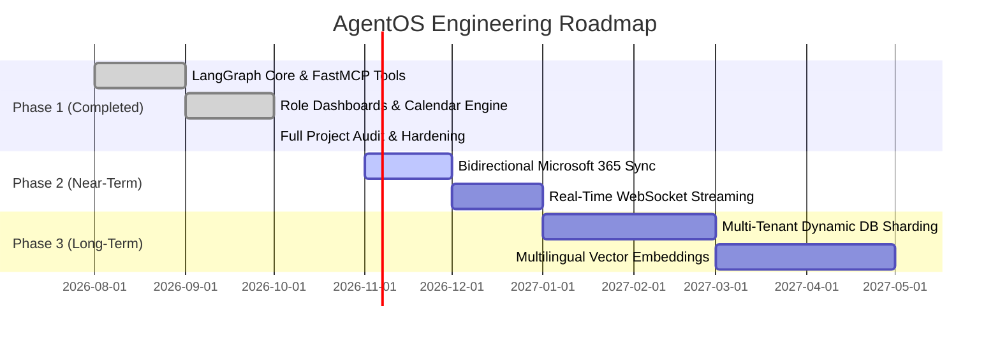

- **Near-Term (Q4 2026):**
  - **Bidirectional Calendar Webhooks:** Ingest external Google Calendar and Microsoft Graph ICS webhooks to detect real-world scheduling conflicts.
  - **Streaming Agent Token Responses:** Upgrade FastAPI REST endpoints to Server-Sent Events (SSE) or WebSockets for real-time word-by-word LLM synthesis streaming.
- **Long-Term (Q1-Q2 2027):**
  - **Multi-Tenant Dynamic Sharding:** Transition from row-level tenant filtering to physically isolated PostgreSQL schemas per enterprise tenant.
  - **Multilingual Policy Embeddings:** Upgrade embedding models to multilingual transformer architectures (`paraphrase-multilingual-MiniLM-L12-v2`) to support global enterprise workforces.
